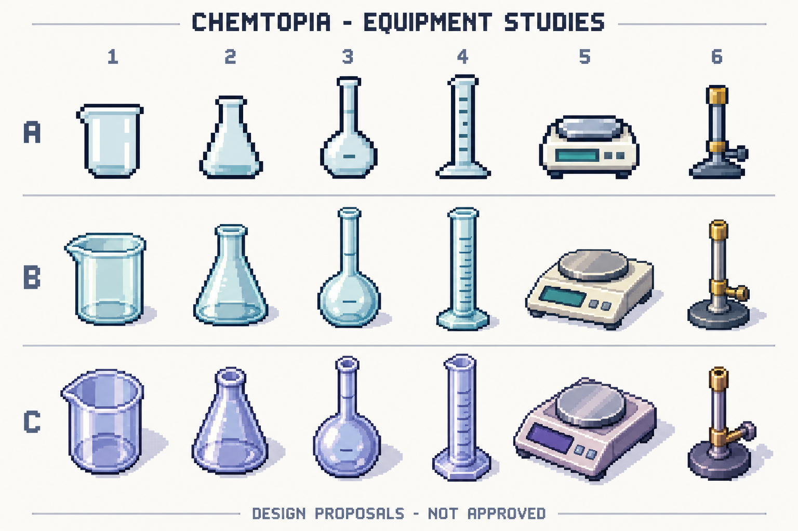
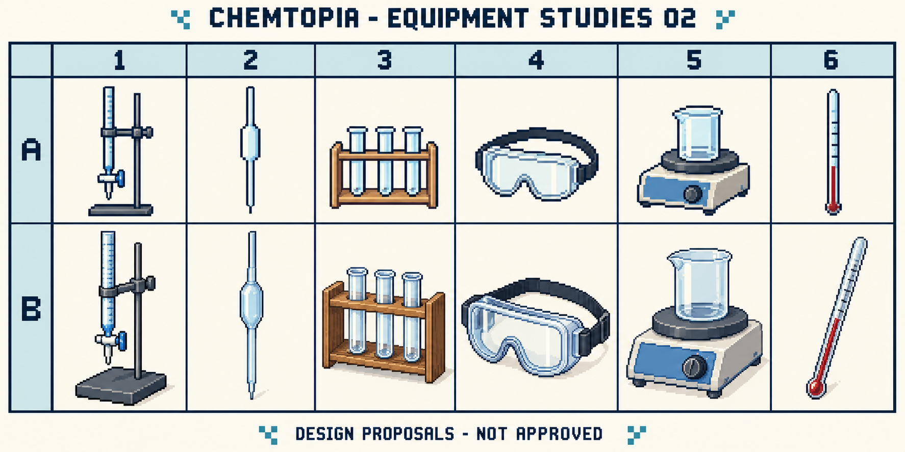
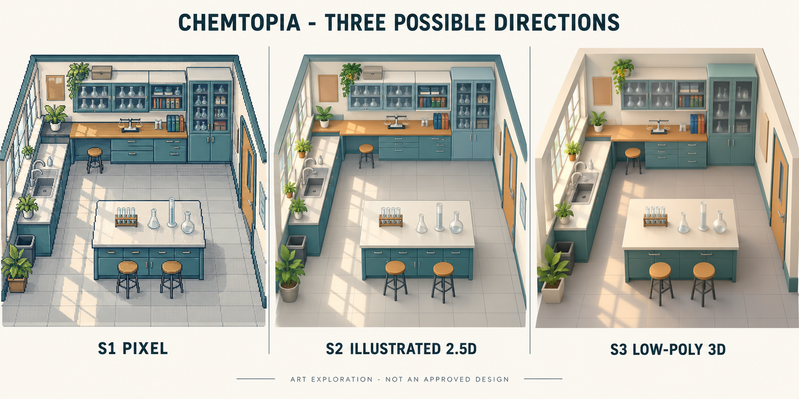

# Forslag til grafikk — til gjennomgang

Bildene her er AI-genererte originalforslag laget med `image_gen` etter uttrykkelig bestilling. De er ikke eksterne referansebilder, ferdige spillressurser eller godkjente fagillustrasjoner. Ingen stil er valgt.

## P01 — Seks typer utstyr, tre stilvarianter

| Kolonne | Tiltenkt utstyr |
| --- | --- |
| 1 | Begerglass |
| 2 | Erlenmeyerkolbe |
| 3 | Målekolbe |
| 4 | Målesylinder |
| 5 | Elektronisk vekt |
| 6 | Bunsenbrenner, uten flamme |

- **A:** enklere og grovere piksler; tydelige mørke konturer.
- **B:** mer detaljert pikselstil med turkise glassflater og lysere apparater.
- **C:** mer skråstilt uttrykk og fiolett palett, som et mulig 2,5D-uttrykk i pikselstil.

Svar med for eksempel **P01-B1** for begerglasset i midterste rad, eller **P01-A** for hele første rad. Radene endrer både detalj, perspektiv og enkelte farger; et valg av én egenskap godkjenner ikke de øvrige.

## P02 — Seks nye utstyrstyper, to stilvarianter

| Kolonne | Tiltenkt utstyr |
| --- | --- |
| 1 | Byrette med stativ og klemme |
| 2 | Volumpipette |
| 3 | Reagensrørstativ |
| 4 | Vernebriller |
| 5 | Varmeplate med mulig magnetrørerfunksjon |
| 6 | Termometer |

**A** er enklere og mer frontalt. **B** har flere detaljer og mer synlig dybde. Svar med for eksempel **P02-A4** eller **P02-B**.

## S1–S3 — Samme laboratorium som stilundersøkelse

- **S1:** pikselpreget uttrykk.
- **S2:** tegnet 2,5D med glatte former.
- **S3:** et mykere, 3D-preget diorama.

Dette er ett generert bilde. S2 og S3 ligger visuelt ganske nær hverandre; forskjellen er mindre enn bestilt. Panelet S3 er **ikke** et skjermbilde av en faktisk 3D-modell eller et bevis på en bestemt spillmotor. Bildet alene kan ikke avgjøre ytelse, mobilbruk eller produksjonskostnad.

Innredning, planter, benker, farger og plassering av utstyr er forslag. De er ikke godkjente deler av laboratoriet.

## Hva som må bearbeides før eventuell spillbruk

- Disse arkene er store konseptbilder, ikke spriteark med et fast pikselrutenett eller vedtatte 32/64-pikslers ressurser.
- Målekolbenes kalibreringsmerker og bunnform må gjennomgås. Enkelte genererte merker ser ut som dekorative streker på kolbekroppen; det skal ikke videreføres som faglig informasjon.
- Skalaer på målesylindre, byretter og termometre er skisser. De har ingen godkjent verdi eller målefunksjon.
- Glass, fot, tut, klemmer og apparatdeler varierer mellom radene. Gjenkjennelse og faglig form må kontrolleres før en variant videreutvikles.
- Farge eller glans i glass skal ikke automatisk bety en bestemt løsning, temperatur eller annen kjemisk tilstand.
- En valgt stil trenger et eget, lite forsøk med korrekt størrelse, kontrast og lesbarhet på telefon før produksjon av mange ressurser.

Dette er kvalitetsoppgaver for en senere godkjent grafikkrunde. Ingen av illustrasjonene brukes i et spill nå.

## Opphav og sporbarhet

[generated-sources.json](generated-sources.json) registrerer verktøy, bestillingens hovedinnhold, fil og kontrollsum. Originale genererte filer er beholdt utenfor repositoryet; kopiene her er uendret. Ingen ressurser fra tidligere prosjekt er brukt. Eventuell prosjektlisens er ikke valgt; eksterne referansers lisenser gjelder ikke automatisk disse bildene.

Neste valg kan tas i [morgendagens gjennomgang](../design/review-tomorrow.md).
