# Flere Equipment Studies — P03–P14

Tolv nye AI-genererte konseptark i stilen du likte, med **72 utstyrsmotiver og 144 varianter**. Hvert ark har seks motiver i to rader. Utstyret er foreslått som visuell referanse; dette er ikke en godkjent utstyrsliste for spillet eller en utvidelse av første versjons faglige omfang.

**A** er enklere og vanligvis mer frontalt. **B** har flere detaljer og et mer skrått perspektiv. Et enkelt objekt velges med ark, rad og kolonne: **P08-B2** betyr multimeteret i nederste rad på ark 08.

Noen forskjeller gjelder også form, farge og perspektiv. Du kan derfor like formen i én celle og paletten i en annen. Arkene er ikke skalert til et fast pikselrutenett eller laget som gjennomsiktige spillressurser.

## Hurtigoversikt

| Ark | Tema | Motiver |
| --- | --- | --- |
| [P03](#p03) | Håndtering og småutstyr | Spruteflaske, Pasteurpipette med gummitopp, Pipettefyller med mer |
| [P04](#p04) | Filtrering og tørking | Glasstrakt, Büchnertrakt, Sugekolbe med mer |
| [P05](#p05) | Oppvarming og porselen | Trefot, Trådnett med keramisk sentrum, Digel med lokk med mer |
| [P06](#p06) | Måling og sensorer | pH-meter med elektrode, Konduktivitetsmåler med probe, Temperaturlogger med probe med mer |
| [P07](#p07) | Separasjon og glassdeler | Skilletrakt med stativ, Rundkolbe, Liebigkjøler med mer |
| [P08](#p08) | Elektrokjemi og elektrisk utstyr | Laboratoriestrømforsyning, Multimeter med prober, Grafittelektroder med mer |
| [P09](#p09) | Optisk analyse og kromatografi | Kolorimeter, UV–vis-spektrofotometer, Kyvette med mer |
| [P10](#p10) | Sikkerhet og oppbevaring | Øyeskyllestasjon, Brannteppebeholder, Laboratoriefrakk med mer |
| [P11](#p11) | Småredskaper | Morter med pistill, Tiltenkt glasstav — B2 må korrigeres, Dråpeplate med mer |
| [P12](#p12) | Stativer og støtter | Stativ med fot og stang, Muffe, Trefingerklemme med mer |
| [P13](#p13) | Benkapparater | Vannbad, Tørkeskap, Mekanisk rører med stativ med mer |
| [P14](#p14) | Presisjonsinstrumenter | Analysevekt med trekkskjerm, Mikropipette, Stativ med pipettespisser med mer |

## P03 — Håndtering og småutstyr

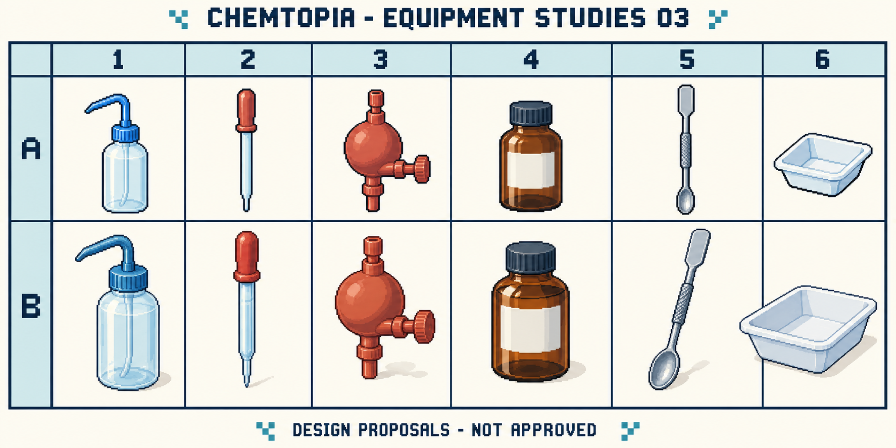

| Kolonne | Tiltenkt utstyr i rad A og B |
| --- | --- |
| 1 | Spruteflaske |
| 2 | Pasteurpipette med gummitopp |
| 3 | Pipettefyller |
| 4 | Brun reagensflaske |
| 5 | Dobbel laboratorie-spatel |
| 6 | Veieskål |

## P04 — Filtrering og tørking

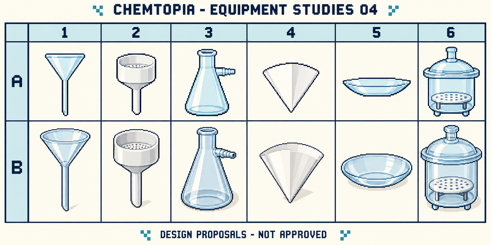

| Kolonne | Tiltenkt utstyr i rad A og B |
| --- | --- |
| 1 | Glasstrakt |
| 2 | Büchnertrakt |
| 3 | Sugekolbe |
| 4 | Brettet filterpapir |
| 5 | Urglass |
| 6 | Eksikkator |

## P05 — Oppvarming og porselen

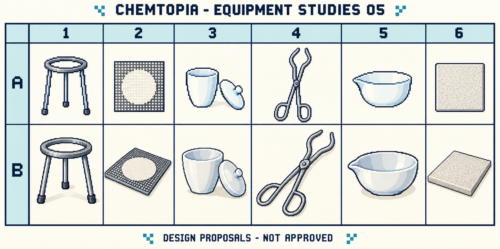

| Kolonne | Tiltenkt utstyr i rad A og B |
| --- | --- |
| 1 | Trefot |
| 2 | Trådnett med keramisk sentrum |
| 3 | Digel med lokk |
| 4 | Digeltang |
| 5 | Porselensskål til inndamping |
| 6 | Varmebestandig underlag |

## P06 — Måling og sensorer

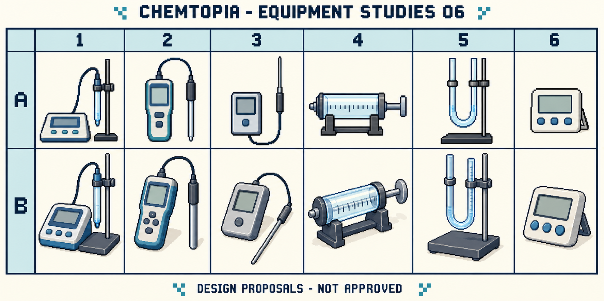

| Kolonne | Tiltenkt utstyr i rad A og B |
| --- | --- |
| 1 | pH-meter med elektrode |
| 2 | Konduktivitetsmåler med probe |
| 3 | Temperaturlogger med probe |
| 4 | Gassprøyte |
| 5 | U-rørsmanometer |
| 6 | Laboratorietimer |

## P07 — Separasjon og glassdeler

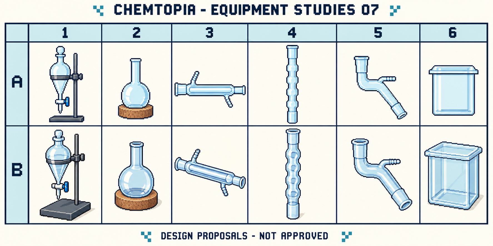

| Kolonne | Tiltenkt utstyr i rad A og B |
| --- | --- |
| 1 | Skilletrakt med stativ |
| 2 | Rundkolbe |
| 3 | Liebigkjøler |
| 4 | Tiltenkt Vigreux-kolonne — må korrigeres |
| 5 | Destillasjonsadapter med sidearm |
| 6 | Kromatografikammer |

## P08 — Elektrokjemi og elektrisk utstyr

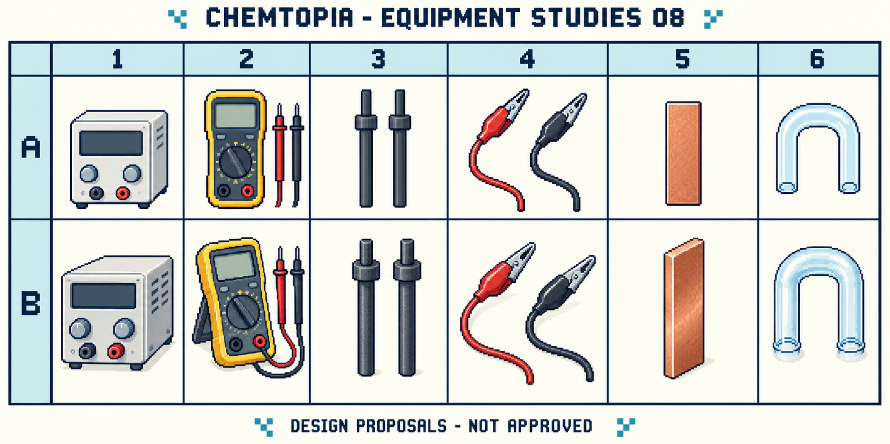

| Kolonne | Tiltenkt utstyr i rad A og B |
| --- | --- |
| 1 | Laboratoriestrømforsyning |
| 2 | Multimeter med prober |
| 3 | Grafittelektroder |
| 4 | Ledninger med krokodilleklemmer |
| 5 | Kobberstrimmel |
| 6 | U-formet glassrør til saltbro |

## P09 — Optisk analyse og kromatografi

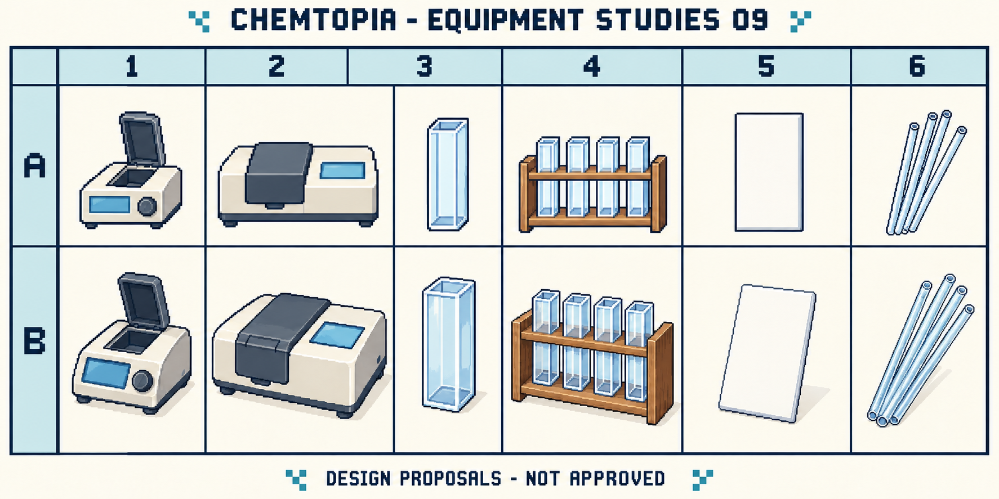

| Kolonne | Tiltenkt utstyr i rad A og B |
| --- | --- |
| 1 | Kolorimeter |
| 2 | UV–vis-spektrofotometer |
| 3 | Kyvette |
| 4 | Kyvettestativ |
| 5 | Tom TLC-plate |
| 6 | Kapillærrør |

## P10 — Sikkerhet og oppbevaring

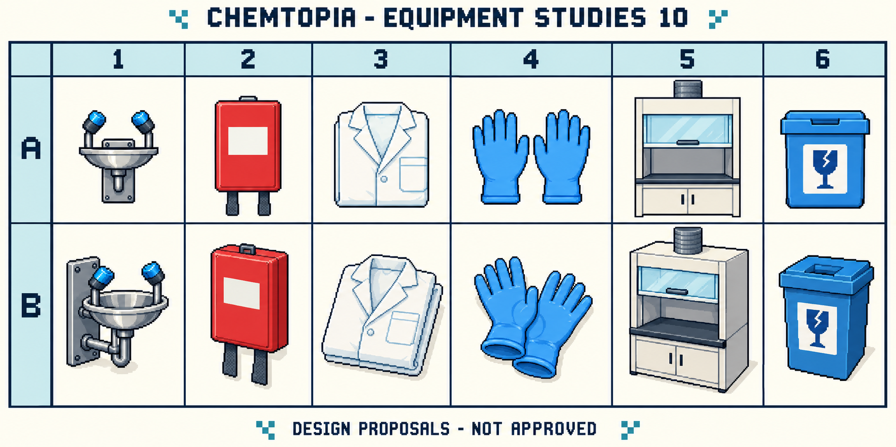

| Kolonne | Tiltenkt utstyr i rad A og B |
| --- | --- |
| 1 | Øyeskyllestasjon |
| 2 | Brannteppebeholder |
| 3 | Laboratoriefrakk |
| 4 | Nitrilhansker |
| 5 | Avtrekksskap |
| 6 | Beholder for knust glass |

## P11 — Småredskaper

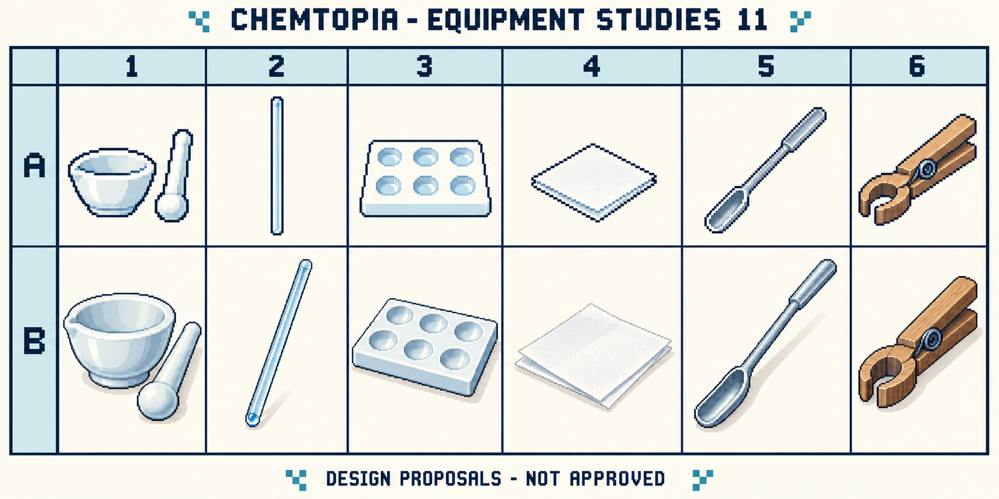

| Kolonne | Tiltenkt utstyr i rad A og B |
| --- | --- |
| 1 | Morter med pistill |
| 2 | Tiltenkt glasstav — B2 må korrigeres |
| 3 | Dråpeplate |
| 4 | Veiepapir |
| 5 | Skjeformet metallspatel |
| 6 | Reagensrørholder i tre |

## P12 — Stativer og støtter

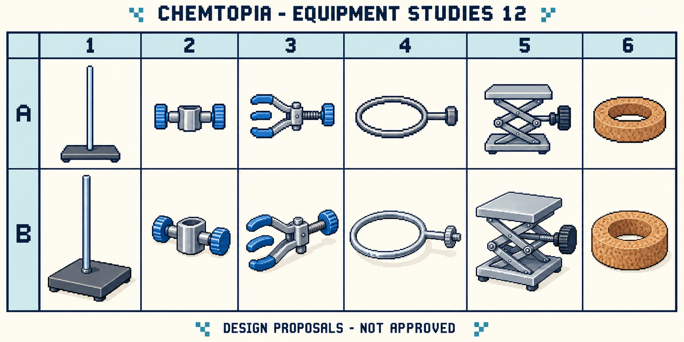

| Kolonne | Tiltenkt utstyr i rad A og B |
| --- | --- |
| 1 | Stativ med fot og stang |
| 2 | Muffe |
| 3 | Trefingerklemme |
| 4 | Stativring |
| 5 | Laboratorieløftebord |
| 6 | Korkring |

## P13 — Benkapparater

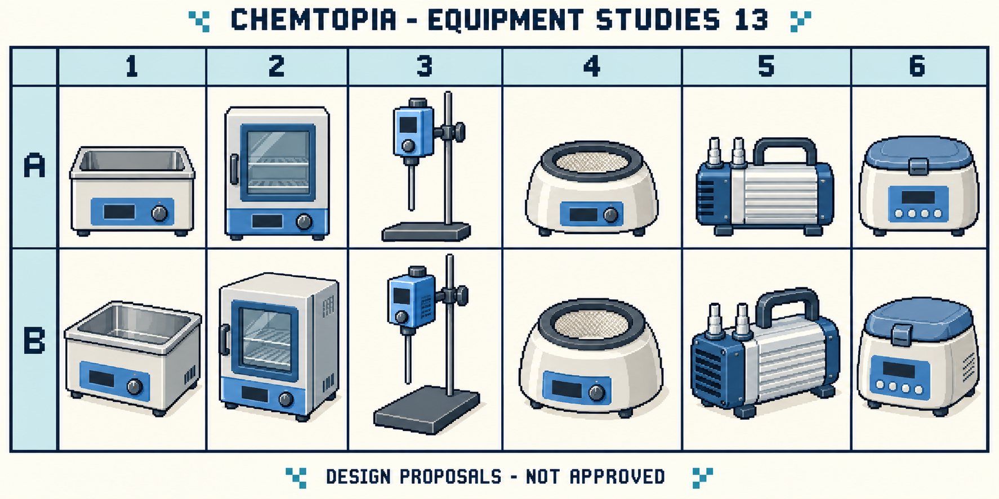

| Kolonne | Tiltenkt utstyr i rad A og B |
| --- | --- |
| 1 | Vannbad |
| 2 | Tørkeskap |
| 3 | Mekanisk rører med stativ |
| 4 | Varmemantel |
| 5 | Vakuumpumpe |
| 6 | Benksentrifuge |

## P14 — Presisjonsinstrumenter

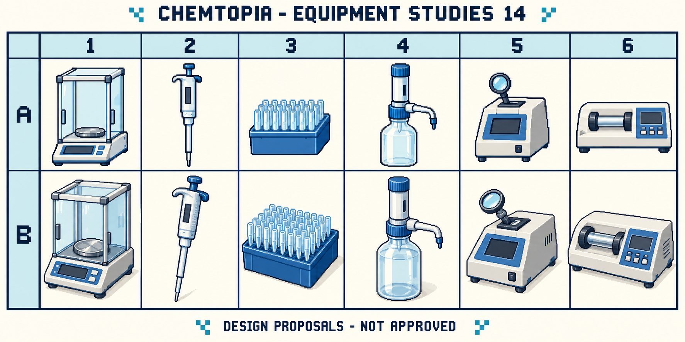

| Kolonne | Tiltenkt utstyr i rad A og B |
| --- | --- |
| 1 | Analysevekt med trekkskjerm |
| 2 | Mikropipette |
| 3 | Stativ med pipettespisser |
| 4 | Flasketoppdispenser |
| 5 | Smeltepunktsapparat |
| 6 | Digitalt polarimeter |

## Synlige detaljer til bearbeiding

Bildene er gjennomgått som konseptforslag. Dette er ikke faglig godkjenning av apparatene. Blant detaljene som må rettes eller avklares før eventuell spillbruk:

- **P04-A4/B4:** filterpapiret ser mer ut som en brettet flate enn en tydelig åpen filterkjegle. Tredimensjonal form bør tegnes mer entydig.
- **P06-A5/B5:** manometeret inneholder blå visuelle felt. Disse har ingen godkjent betydning som væske eller avlesning. Instrumentprober trenger også tydeligere funksjonell detaljering ved en eventuell nærvisning.
- **P07-A4/B4:** den bestilte Vigreux-kolonnen ble tegnet med utvendige buler, mer som en kulekjøler. Dette er en feil i konseptet; en korrekt Vigreux-geometri med innvendige innstikk må tegnes i en senere revisjon.
- **P07-A3/B3 og A5/B5:** glassbaner, skjøter og sidearmer må kontrolleres mot et valgt virkelig apparat før bruk som forklarende fagillustrasjon.
- **P10:** sikkerhetsbeholdere og symboler er stilforslag, ikke godkjente standardiserte skilt eller instrukser.
- **P11-B2:** enden ser hul ut, som et glassrør. Den tiltenkte glasstaven skal være massiv. Dette må rettes dersom motivet skal videreføres.
- **P12-A2/B2:** muffens faktiske festeåpninger og skruer trenger en tydeligere mekanisk gjennomgang.
- **P13-A5/B5:** motivet kan brukes til å diskutere en generell vakuumpumpe. Det er ikke verifisert som den spesifikke membranpumpetypen i bestillingen.
- **P14:** pipettespisser, mikropipettens deler og presisjonsinstrumentenes betjening må kvalitetssikres dersom vi går videre fra silhuettstudie til faglig grafikk.

Genererte skalaer, porter, skjermer og symboler skal ikke brukes som fagdata. Forslagene innebærer ingen bruk av kjemikalier eller godkjent forsøksmetode.

## En enkel måte å svare på

Du trenger ikke vurdere alt i én melding:

- Favorittark: ___
- Foretrukket rad eller celler: ___
- Former jeg vil beholde: ___
- Farger eller detaljer jeg vil endre: ___
- Utstyr jeg savner: ___
- Utstyr jeg ikke vil prioritere: ___

Eksempel: «P03-B4 og P08-B2 liker jeg; behold fargene fra P01-B. Lag senere en faglig korrigert P07-B4.» Det er et eksempel på svarformat, ikke en foreslått beslutning.

## Opphav

Laget med `image_gen`, med P02 som stilreferanse. Eksakte bestillinger og motiver er bevart i [genereringsloggen](equipment-generation-03-14.json). [Kildemanifestet](generated-sources.json) inneholder kontrollsummer og filstørrelser. Bildene er kopiert uendret fra verktøyets originaler. Ingen eksterne eller tidligere prosjektressurser er importert i denne runden.

Tilbake til [grafikkoversikten](README.md).
