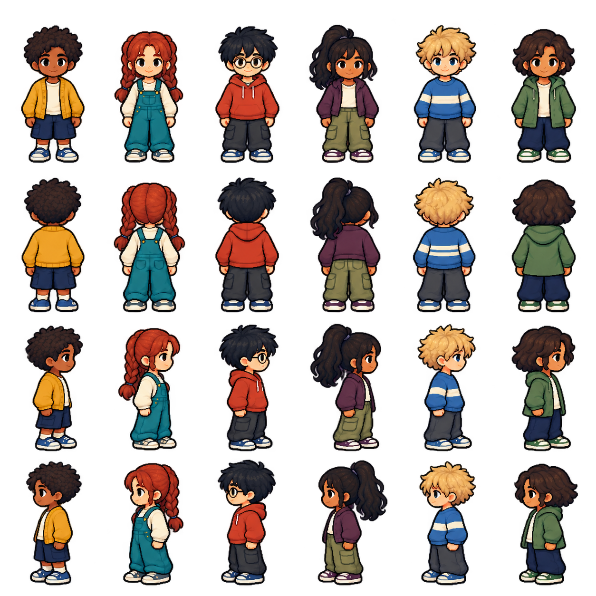
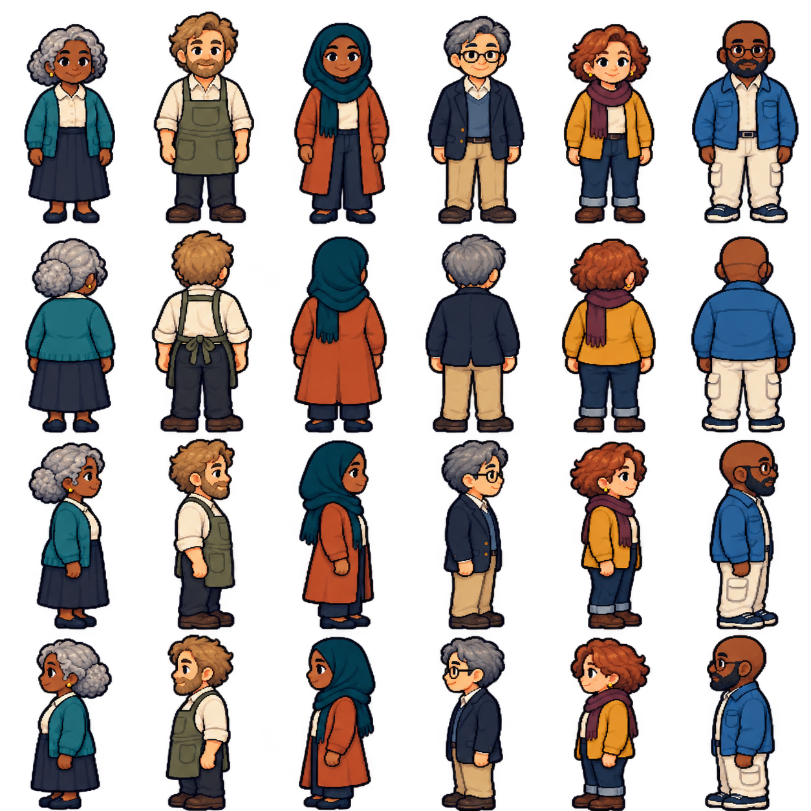
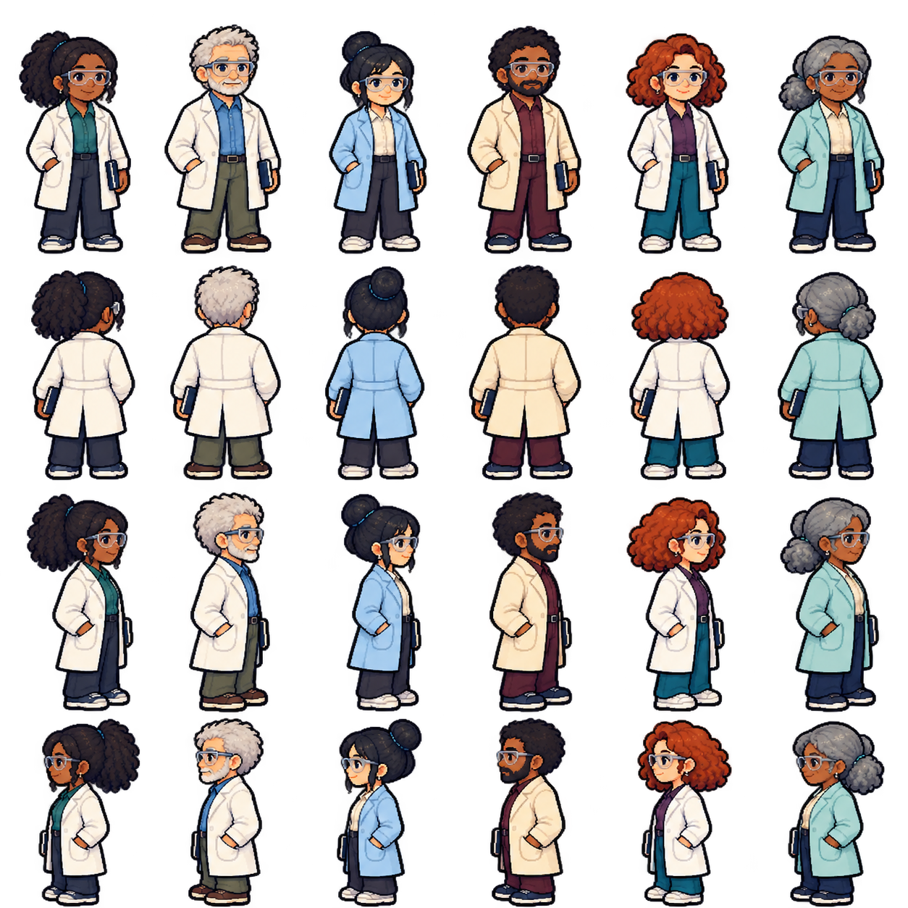

# NPC character studies — N01–N03

The owner requested more NPC characters: children, adults, chemists and others. These eighteen new appearances follow the detailed B pixel-art direction and the existing C01 character rendering. They do not replace any of the six selected player avatars.

Each updated sheet has six characters across four rows: south/front, north/back, east/right profile, west/left profile. IDs run left to right. All poses are standing still; the east and west views are separately drawn. Roles below are suggestions, not assigned quests, fixed personalities or final names.

Run `npm start` and open **http://127.0.0.1:4173/npc-preview.html** to compare all eighteen characters in all four directions, including on a phone.

## N01 — Children and younger students

| ID | Suggested role |
| --- | --- |
| N01-1 | Curious child |
| N01-2 | Young nature explorer |
| N01-3 | Library visitor |
| N01-4 | School visitor |
| N01-5 | Science-club member |
| N01-6 | Young town explorer |

These are younger town residents and visitors, not replacements for the IB student player characters. Their presence does not imply unsupervised laboratory tasks.

## N02 — Adult townspeople

| ID | Suggested role |
| --- | --- |
| N02-1 | Town resident |
| N02-2 | Workshop keeper |
| N02-3 | Town visitor |
| N02-4 | Retired teacher |
| N02-5 | Local organiser |
| N02-6 | Equipment caretaker |

## N03 — Chemists and laboratory staff

| ID | Suggested role |
| --- | --- |
| N03-1 | Research chemist |
| N03-2 | Senior chemist |
| N03-3 | Laboratory technician |
| N03-4 | Analytical chemist |
| N03-5 | Chemistry teacher |
| N03-6 | Laboratory mentor |

## Status and reuse

- Updated generated character appearances with static east, north, west and south views. NPC walking cycles are not included in this increment; the six playable characters retain their existing four-direction animations.
- Inspected silhouette bounds align standing height and foot baseline across directions. Stable definitions and a reusable SVG renderer live in `prototype/npc-characters.js`. The gallery uses those definitions rather than duplicating character mappings.
- No town NPCs, dialogue, quests, practical success checks or rewards are added. The owner explicitly deferred quest implementation.
- Generation prompts, unchanged source filenames and checksums are recorded with the assets. The source C01 sheet provides the style reference; the new NPCs are distinct identities.
- Later review: choose favourite IDs, assign town positions and names, then decide who gives which practical task before implementing quests.

## Idle behaviour

All eighteen NPCs now share the [idle animation system](idle-animations.md): breathing, blinks wherever eyes are visible, and occasional south-facing personality actions. The four-direction NPC gallery animates its portraits; `/idle-preview.html` also includes the six players and an immediate gesture demonstration.
