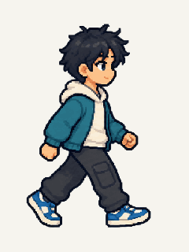
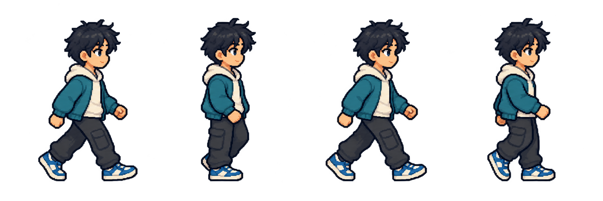

# W01 — Walking animation preview



This is an **actual four-frame looping GIF**, provided to assess M01-1 in motion. It uses C01-1 as a sample; all six avatars remain player options and no default avatar is chosen. It is not a runnable game or approval of the final movement style.

## What to assess

- Does the pace feel comfortable, too fast or too slow?
- Does the overall body motion fit the detailed design B style?
- Should the final map character be smaller or less detailed?

The source still has similar contact poses and small changes in hair, limbs and silhouette. Alternating near/far legs need a clearer production pass. This preview should not be treated as a finished four-direction walk cycle. The 140 ms frame duration is a review setting, not an adopted gameplay requirement.

## Source frames



The artwork was generated with `image_gen` using C01 as the reference and selecting C01-1. The source image is unchanged. Equal-width cells were extracted and registered by their upper silhouette, displayed against an ivory background and encoded as a GIF. No chemistry or game mechanics are represented.

- [Generation prompt and source details](walk-generation-w01.json)
- [GIF assembly script](scripts/assemble-walk-preview.sh)
- [Checksums and provenance](generated-sources.json)

To regenerate the GIF with installed ImageMagick, run from the repository root:

```bash
bash docs/art/scripts/assemble-walk-preview.sh
```

The script uses a temporary directory and checks source dimensions before extracting cells. The GIF loops automatically when displayed; the static strip above is available for a still-image review.
