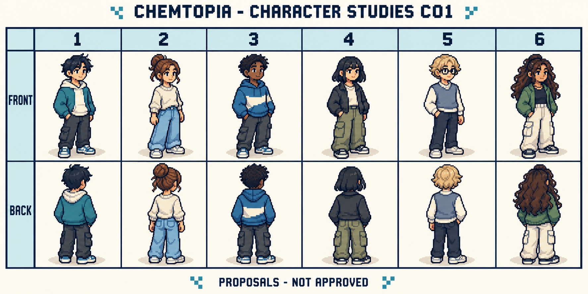
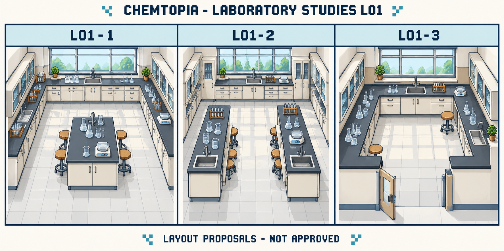
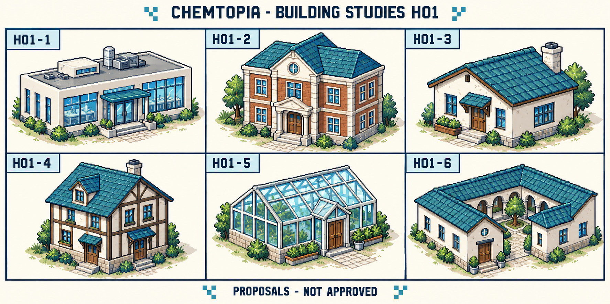
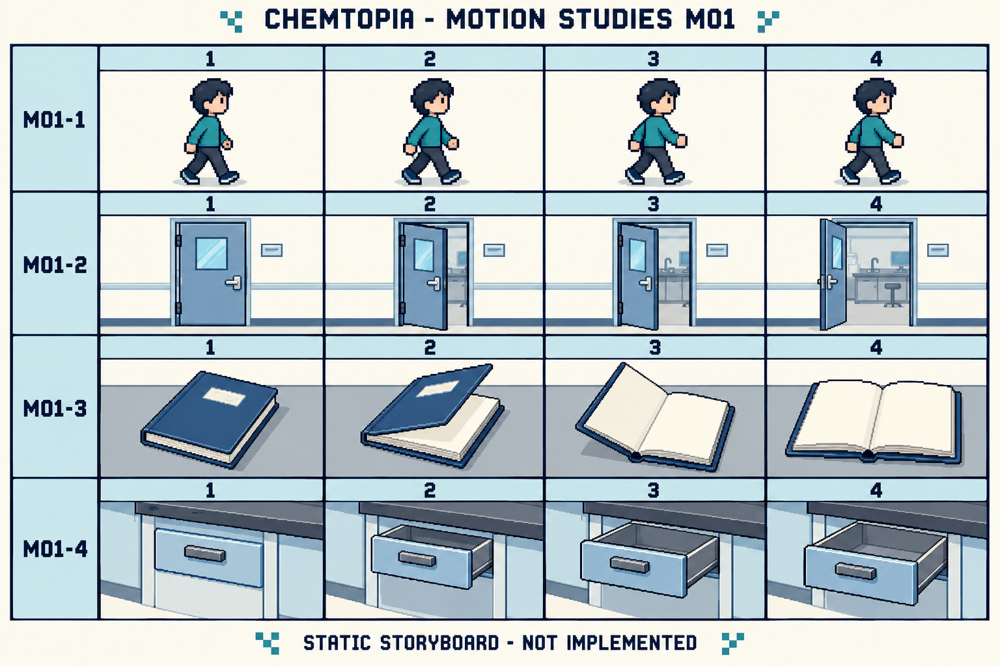

# Characters, laboratory, buildings and motion — row B proposals

The user particularly likes design B. For these studies, **B is interpreted as the detailed bottom row of the Equipment Studies sheets**, specifically P02. The user has now selected all six C01 avatars as player options, L01-1 as the laboratory layout and H01-1 as its exterior. H01-2–H01-6 are retained for other buildings. These choices establish directions, not unreviewed production details.

The common direction is detailed pixel illustration, dark slate outlines, blue-green glass, ivory surfaces, muted teal accents and a three-quarter view. The larger scenes sometimes look softer than the equipment; a final consistent pixel grid and production scale have not been established.

## Current motion selections

A01–A03 and A05–A08 are accepted directions. A04 (greeting) is rejected. M01-1 still needs motion assessment; [W01 provides an actual looping preview](walking-preview.md). The other M01 directions are liked, with the door angle correction explicitly deferred. Notebook/drawer functionality and scientific content are not automatically approved by accepting their animation directions.

## C01 — Character silhouettes and outfits

Six student-avatar proposals, labelled **C01-1** through **C01-6**, each with front and back views. They explore hair, clothing, skin tones and silhouettes, not names, personalities, gender-locked roles or an approved customisation system.

**Suggested discussion:** select a silhouette or outfit independently of face, hair or skin tone. Consider whether these proportions feel right for students aged 16–19 and whether the character remains clear at map size.

**Tradeoff:** more detailed avatars can feel expressive but require more animation work. These are large character illustrations, not tested map sprites. Clothing shown here is casual concept clothing, not a selected laboratory safety outfit or procedure.

## L01 — Three compact laboratory layouts

| ID | Layout idea | Main tradeoff |
| --- | --- | --- |
| L01-1 | Perimeter benches and a central workstation | Strong home-base identity, but the island can interrupt movement |
| L01-2 | Two short parallel benches and a clear central aisle | Separates work areas, but needs enough space to avoid awkward navigation |
| L01-3 | A horseshoe bench around an open floor | Clear overview, but equipment may feel spread around the room |

These are art/layout proposals, not scientifically validated laboratory plans. Sinks, stools, plants, apparatus placement and the number of workstations are not approved. The views are illustrative cutaways; the actual game camera and phone layout remain undecided.

**Suggested discussion:** compare visibility, compactness and time to reach chemistry. A large explorable room should not be a prerequisite for opening the meaningful activity.

## H01 — Building exteriors

| ID | Architectural proposal |
| --- | --- |
| H01-1 | Compact contemporary laboratory with broad windows |
| H01-2 | Brick-and-ivory school science building |
| H01-3 | Small single-storey house |
| H01-4 | Two-storey timber-and-plaster house |
| H01-5 | Small glass greenhouse |
| H01-6 | Courtyard building |

These are alternative architectural motifs, not six new required locations. Houses and a greenhouse are not assigned gameplay functions, residents, errands or chemistry topics.

**Suggested discussion:** compare contemporary versus traditional architecture, roof colours and entrance clarity. H01-1 and H01-2 could be alternatives for the same laboratory exterior rather than separate buildings.

**Tradeoff:** varied architecture makes places recognisable, but decorative houses can increase travel and art workload without helping learning. Steps in these illustrations do not decide access routes or real/game accessibility; those need deliberate review.

## M01 — Motion storyboards

This is a **static storyboard**, not an animated GIF, working animation or production sprite sheet.

| ID | Proposed motion | Why consider it? | Review needed |
| --- | --- | --- | --- |
| M01-1 | Short walking cycle | Communicates movement clearly | The generated poses are too similar for a proper alternating walk cycle |
| M01-2 | Door opening | Makes a room transition understandable | Intermediate angles are not consistently progressive; redraw before animation |
| M01-3 | Notebook opening | Gives a clear transition into notes, if a notebook is chosen | Preserve scale, hinge and page geometry across frames |
| M01-4 | Drawer opening | Communicates a physical interaction | Opening drawers is not approved gameplay; do not make repeated handling mandatory |

The sample walker is a temporary silhouette, not a selected character. Selecting motion should not automatically add notebooks, inventories, drawer puzzles or extra navigation.

## Further animation directions — selection status recorded above

| ID | Suggestion | Purpose and boundary |
| --- | --- | --- |
| A01 | Subtle idle pose or occasional blink | Adds life; optional, restrained and reduced-motion friendly |
| A02 | Four-direction walking | Fits an overhead world; approve character scale and controls first |
| A03 | A short turn to face an object | Clarifies which object an interaction concerns; must not delay chemistry |
| A04 | A simple greeting gesture | Supports dialogue without lengthy entrances; no character role implied |
| A05 | A brief, optional equipment-selection outline | Helps locate a tool; pair with text and avoid colour-only meaning |
| A06 | Place a selected empty apparatus on a work surface | Makes a chosen action clear, if apparatus placement is approved; allow immediate completion or skipping |
| A07 | A short room transition | Maintains orientation; avoid long fades and provide a low-motion alternative |
| A08 | An optional scientific animation for an approved activity | Only after the phenomenon, model, explanatory limits and scientific content are approved; no reaction effects invented here |

No durations, frame counts or mandatory delays are selected. Decorative motion should not imply experimental observations, correct answers, progress or rewards.

## How to reply

You can select parts rather than whole sheets:

- Characters/outfits I like: ___
- Laboratory layout: L01-___
- Building style: H01-___
- Motions worth exploring: M01-___ / A___
- Details to change: ___
- Things to leave out: ___

For example: “C01-3 silhouette, L01-3 layout, H01-1 exterior; explore A02 and A03.” This is only a response example, not a chosen combination.

## Source and status

All four sheets were generated using `image_gen`, with P02 as the style reference. [world-generation.json](world-generation.json) preserves the prompts and IDs; [generated-sources.json](generated-sources.json) records checksums and files. Images are unchanged copies of the generated originals. No previous-project assets were used. Selection status is recorded above and in the design log. No game code has been implemented; the separate W01 GIF is a motion preview, not an in-game animation.
