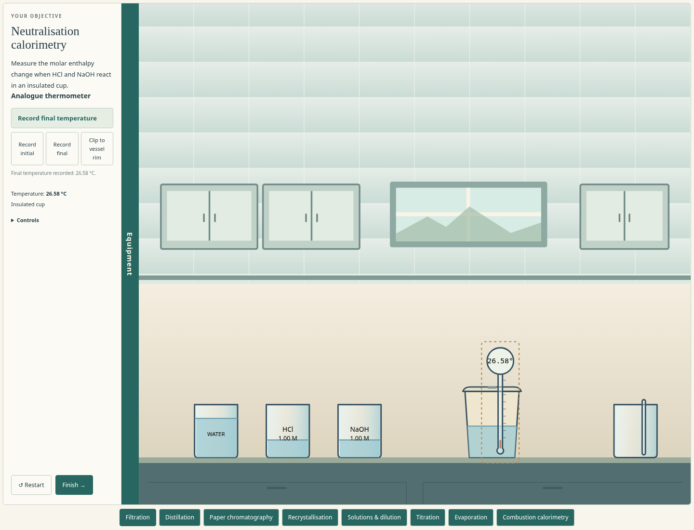
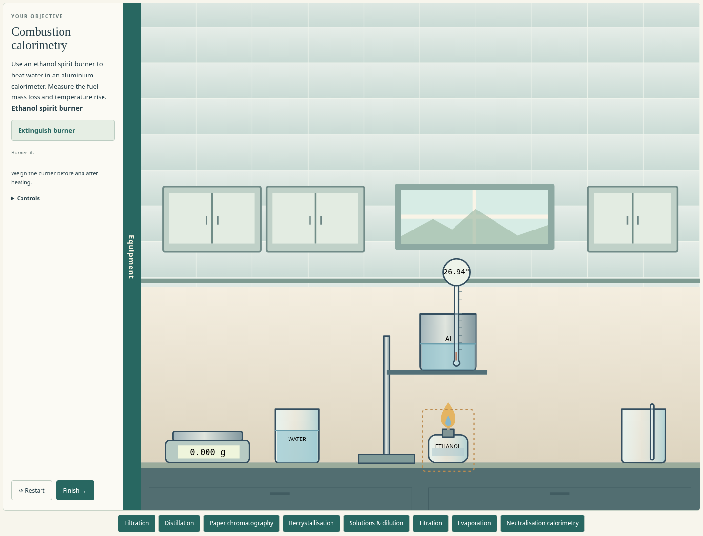

# Calorimetry — controls and review

Run `npm start` in the repository and open `http://127.0.0.1:4173/neutralisation.html` or `/combustion.html`. The **Laboratory** link returns to the room with all nine experiment previews. Each switch starts a fresh attempt. No installation or accounts are needed.

## Previews

These screenshots show original functional SVG apparatus, not final production artwork.

## Neutralisation walkthrough

1. Retrieve the two measuring cylinders. Hold the acid beaker above one and press Space five times for 50 mL; repeat with base and the other cylinder. Each portion stops independently.
2. Pour the acid into the insulated cup. Retrieve the thermometer, move its tip into the liquid and use **Clip to vessel rim**. Select it and **Record initial**.
3. Add the base. Put the stirring rod in/near the cup and press Space to stir. Move it aside. Fit the lid near the cup with Space to reduce heat loss.
4. Watch the analogue/digital thermometer rise, then deliberately record the final temperature. A late reading may miss the peak. Finish to review the recorded data.

Other amounts are possible. The limiting amount controls released energy. Liquid poured onto a fitted lid spills; remove it before filling. Water dilution, poor mixing and heat loss affect the result.

## Ethanol combustion walkthrough

1. Place the spirit burner on the balance pan and **Record mass**. Move it aside before assembling.
2. Measure water into the aluminium can; 100 mL is a convenient example. Lift the can onto the raised support platform. The open side permits moving the burner underneath.
3. Clip the thermometer into the water, stir and record the initial temperature.
4. Move the burner below the can. Select it and press Space or **Light burner**. Observe the temperature rise. Extinguish deliberately, record the final temperature and weigh/record the burner again.
5. Finish. Use total water mass and the aluminium heat capacity, then fuel mass lost / molar mass to calculate apparent molar enthalpy.

Misalignment can burn fuel without useful heating. Excessive heating can boil water away. Heat lost to air and thermometer lag remain in the recorded result. Neither lab replaces observations with an ideal peak. Initial temperatures are 20 °C.

## Review and limitations

Each lab has three questions: energy transfer, numerical heat gained, then signed apparent molar enthalpy. Retry is available. Incomplete data uses a labelled supplied calculation example. Measured attempts retain their actual numbers. The neutralisation calculation initially neglects cup heat capacity; combustion explicitly includes the 50 g aluminium container.

[The specification](calorimetry-prototype-spec.md) records the energy/material accounting, constants, source edition and limitations. Fuel coefficients and heat-transfer rates are teaching-model defaults. This is a two-dimensional learning prototype, not a calibrated burner or safety-training simulation. Owner playtesting of these labs and the preceding titration remains pending.

## Verification

The model checks cover limiting reaction amount, warm-parcel transfers, reduced heat loss with a lid, thermometer response/mixing, closed-lid spills, position-dependent combustion, extinguishing/cooling, before/after burner masses, aluminium heat capacity, boiling/vapour conservation, storage, completion freeze, signed molar results and physical support. Browser checks exercise native mouse/keyboard actions and numerical review; the layout check covers all nine workbenches at desktop, wide and mobile sizes.

Run `npm test`, `node tests/calorimetry-browser.mjs`, and `node tests/layout-browser.mjs`; `npm run test:browser` includes the new workbenches alongside existing regression checks. Chromium is required for browser tests.

Verification on 23 October 2026: all **163 model tests** and the complete **10-script browser suite** passed, including both calorimetry walkthroughs and nine-lab responsive layout checks. The walkthroughs use native Chromium pointer/keyboard events without injecting experiment state. Documentation links and `git diff --check` passed.
