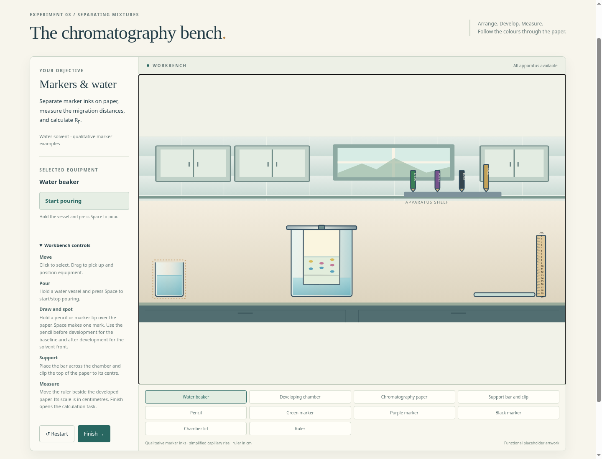
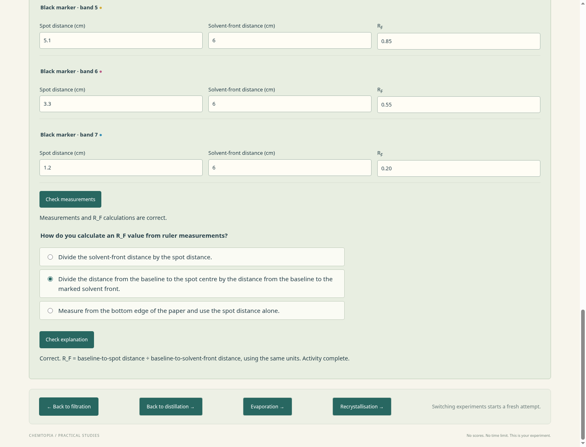
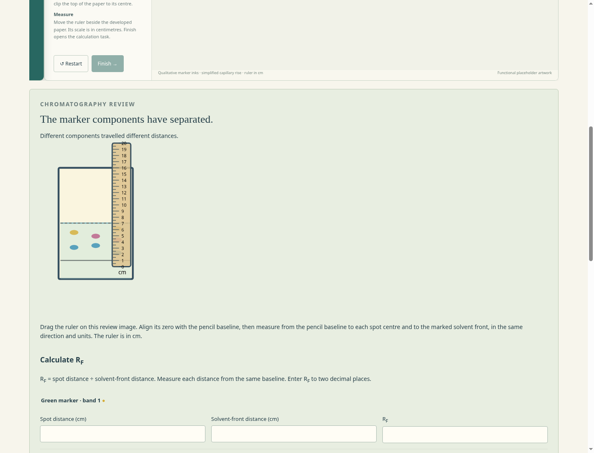

# Paper chromatography prototype review

The owner selected water solvent, markers of different colours and calculating R_F. The playable workbench is available through **Go to paper chromatography** in both other labs. Run `npm start` and open the reported local address.

Use a pencil tip to mark a baseline, then apply marker tips at different positions across that line with Space. Put water in the chamber, arrange the support bar and paper, and watch development. Remove the paper, mark the solvent front with the pencil, and use the ruler. Finish opens measurement, R_F and explanation tasks with retry. The ruler on the review paper can be dragged to align its zero with the pencil baseline; the explanation also focuses on calculating R_F.

The green, purple and black markers are qualitative examples. No commercial marker formulation, chemical identification or measured R_F property is claimed. The strip and tools use the same functional placeholder artwork and rigid-body approximation as the other labs. The wet region and bands move with the paper; water and ink transfers remain conserved. Overlapping repeated applications broaden the visible spots.

Students can submerge a spot, miss the chamber while pouring, overflow it, omit the lid, leave paper without solvent contact, or let the front reach the top. These actions are allowed. Submerged ink enters the chamber liquid; lid omission has no invented numerical penalty. The paper/clip and hollow chamber use bounded containment rules, and marking tools overlay the face of the paper. See [the scientific and interaction specification](chromatography-prototype-spec.md) for defaults and limits.

`npm test` covers all five labs, including chromatography material, development, measurement and physics. `npm run test:browser` exercises all labs, including real marker/pencil actions, pouring, clipping and removing the paper, front marking, ruler placement and review dragging, wrong/correct R_F and explanation answers, a submerged-spot attempt, restart and cross-lab navigation.

Screenshots are captured from the local browser using project-owned SVG placeholders. No external runtime requests, accounts, saving, analytics or publication are introduced.

