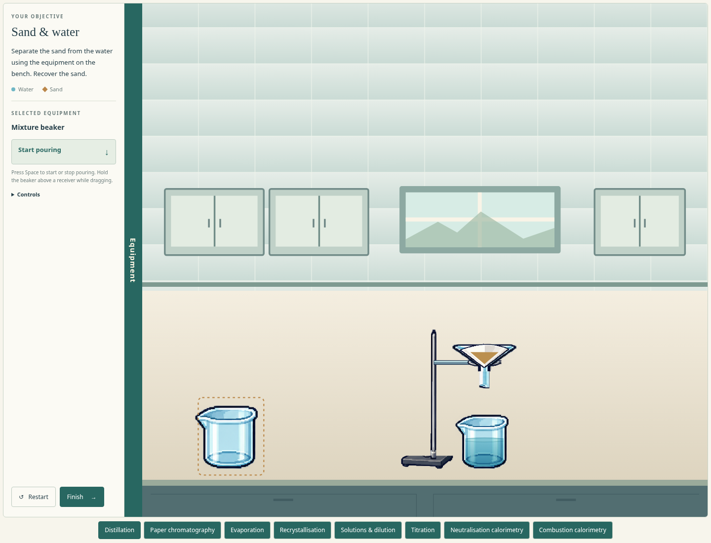
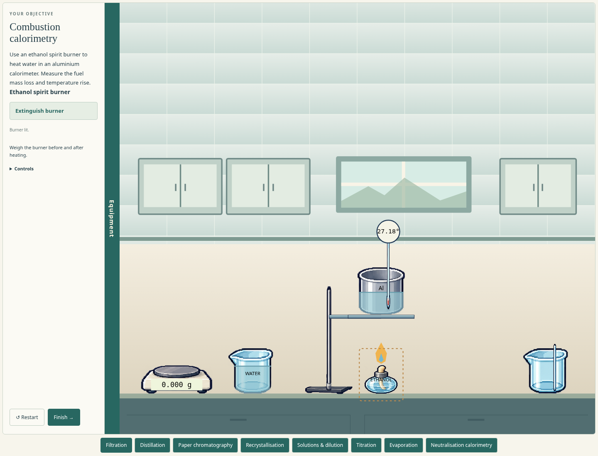
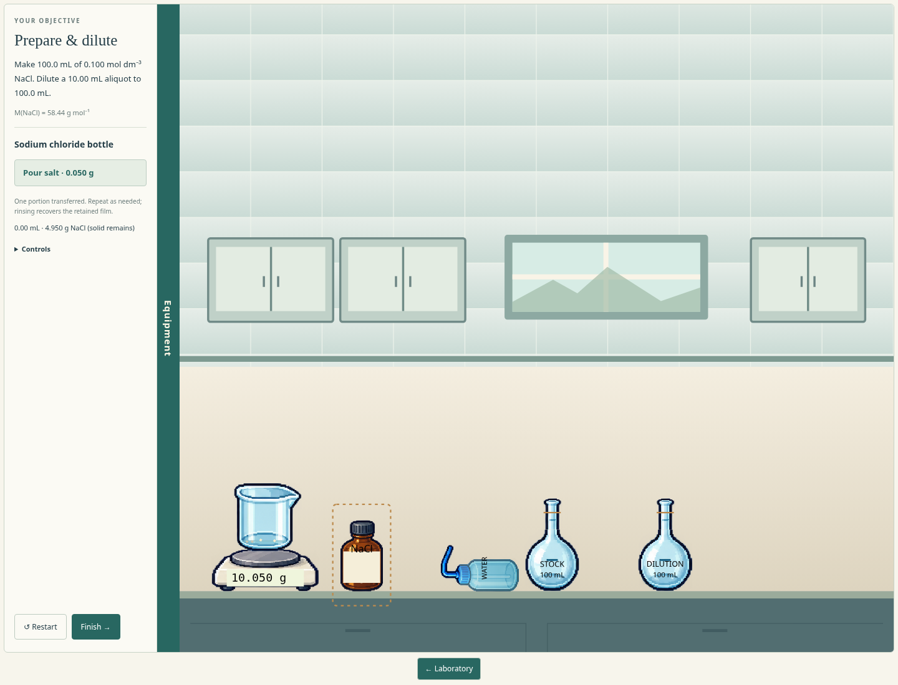

# Detailed B equipment in the labs

The owner asked whether the detailed pixel-art equipment drawings marked B were being used and requested replacing the current equipment with B while preserving physics. The previous workbenches used smooth SVG placeholders. All nine now use a shared sprite adaptation of the selected B studies.

See [the asset source and mapping](../../prototype/assets/design-b/README.md). The original concept sheets remain unchanged. This adaptation prepares them for interaction: transparent backgrounds, individually addressable apparatus and composite pieces for supports and glass joints. Matching sprites cover newer calorimetry apparatus. It does not add any new chemistry or equipment choices to the labs.

## In-game preview

## What remains functional

The art fits the existing local coordinates and physical bodies. Vessel bottoms, funnel bowls/stems, support rings, thermometer tips, the sloped condenser and the angled still-head outlet retain their experiment anchors. Contact, friction, falling, tipping, spilling, storage and attachments continue using the existing physics. Drawing detail is not used as an opaque rectangular collider.

Liquid levels, particles, salts/crystals, chromatography marks/bands, indicator colours, real measuring scales, live thermometer columns and digital displays are rendered separately from the image. Thus a detailed drawing does not impose a fixed water level, false indicator colour, fixed temperature or unreadable fake instrument value. The existing ruler and paper remain directly measurable.

## Try it

Run `npm start` and open the local address. The updated art appears in each lab and when apparatus is retrieved from Equipment. Complete the labs as before; no installation or new control scheme is needed.

## Verification

Run `npm test` for conservation, chemistry and physics, and `npm run test:browser` for real mouse/keyboard assembly and completion. The responsive layout test now also checks that each of the nine pages uses and successfully loads the local B sprite atlas. The native walkthroughs cover stand contacts, unsupported falls/tipping, filtration, distillation hose reversal and joints, chromatography measurements, heaters, dissolution, volumetric preparation, titration and both calorimetry activities.

The models and physics implementation are unchanged by this visual revision. Owner visual/playtesting review remains pending.

Verified on 23 October 2026: **163/163 model tests** passed. All **ten browser test scripts** passed on the final rendering, including all nine pages at desktop, wide and phone sizes. Native checks cover assembly, supported/unsupported contacts, tipping/spilling, storage, material transfer, measurement and all lab reviews. Navigation polling now tolerates Chromium replacing its context during a page load; application exceptions still fail the checks. Documentation links and `git diff --check` passed.

## Owner playtest corrections — 24 October 2026

The earlier checks did not establish that every artwork anchor or practical interaction looked right. The owner found misalignment, unsupported-looking preview equipment, reversed spouts, blocked transfers and missing beaker weighing. These are corrected in the current revision:

- Explicit glass-interior clips contain liquid and individual solid grains; sprites are no longer used as the contents mask for vessels. Volumetric neck/bulb pieces follow the existing model geometry.
- Beaker spouts face right, matching clockwise pouring; continuous stream origins follow them. Discrete delivery accepts centre or lip alignment without a timing challenge. Direct solid-bottle portions supplement spatulas.
- All lab bench drawings meet the existing physical surface at y=525 instead of y=545.
- Solution balances weigh and tare a beaker with its contents; the combustion balance recognises a beaker too. Empty masses are teaching defaults (beaker 50 g, volumetric flask 60 g).
- Room previews include missing support arms/clamps, a resting pencil and no hover displacement.

Validation: 187 model tests pass. The twelve browser harnesses were exercised across the correction run, with affected pouring workflows rerun after outlet changes. Native checks cover high-clearance liquid pouring, direct salt pouring into a tared beaker (10.050 g after 10 mL water plus 0.050 g salt), solid grains, existing experiment completion, responsive layouts, and laboratory navigation. Owner review of these corrections remains pending.
