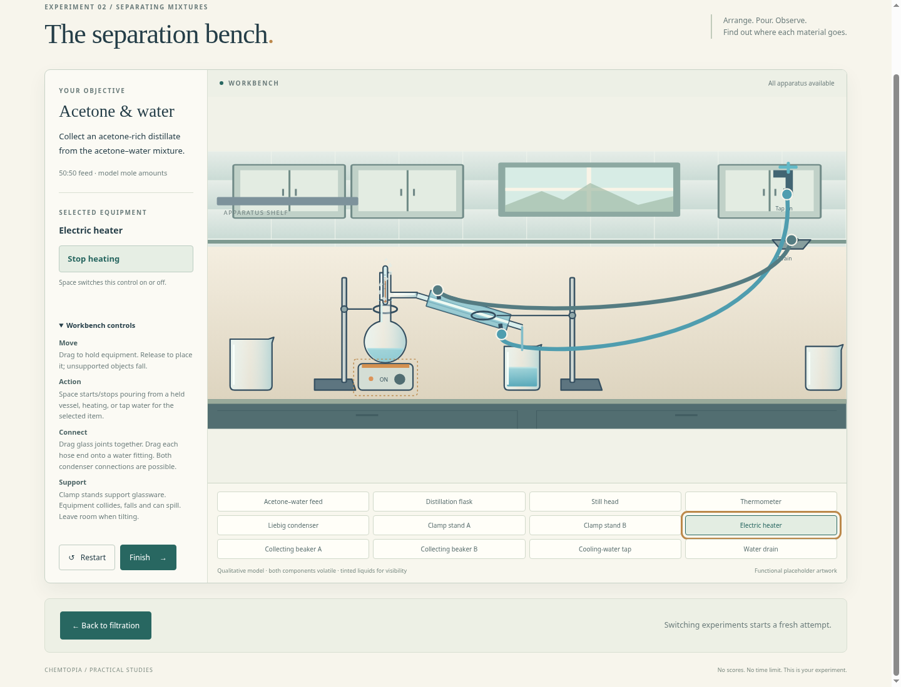
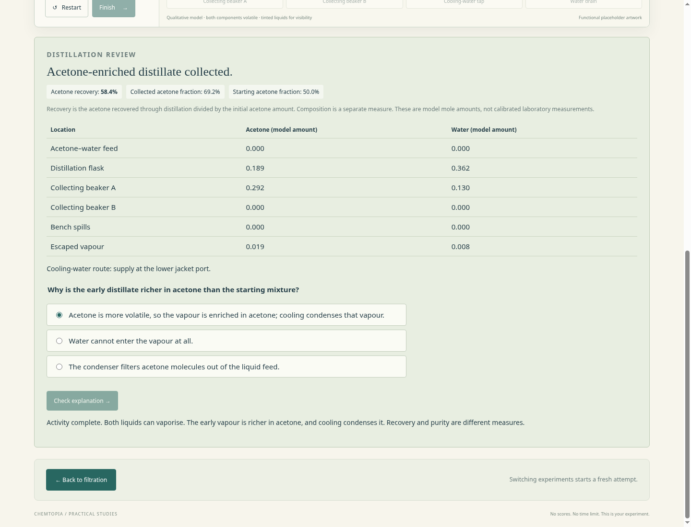

# Distillation prototype review

Run `npm start`, open the local address reported by the server, and use **Go to distillation** at the bottom of filtration. See [controls and limits](../../prototype/README.md#distillation).

The approved 50:50 acetone–water feed is separate from the condenser coolant. Drag and pour the feed, assemble and clamp the glassware, connect either hose end to any free water fitting, then operate the tap and electric heater. Both jacket-port supply choices work; the upper-fed route represents less effective jacket filling and lower recovery. Finish separates acetone recovery from collected composition, and offers the explanation question after collecting enriched distillate.

Screenshots are generated from the local Chromium playthrough using project-owned functional SVG placeholders. They illustrate one attempt, not a prescribed layout or calibrated numerical prediction. Final pixel artwork, more realistic glass geometry, pressure and quantitative vapour–liquid equilibrium are outside this increment.

Verification includes both component balances, evolving vapour composition, cooling circuits, matched lower/upper-fed model runs, a heated rigid assembly and filtration regressions. Chromium tests exercise actual apparatus dragging, Space pouring, glass and clamp contacts, four hose-end connections, tap/heater controls, collection, question retry, restart and fresh return to filtration.

The implementation passed 33 Node material/physics checks and both Chromium suites. A matched browser comparison recovered approximately 58% versus 30% of starting acetone for lower-fed versus upper-fed coolant. These numbers describe a test attempt under qualitative parameters, not real laboratory performance.

Review this experiment before starting another activity.
