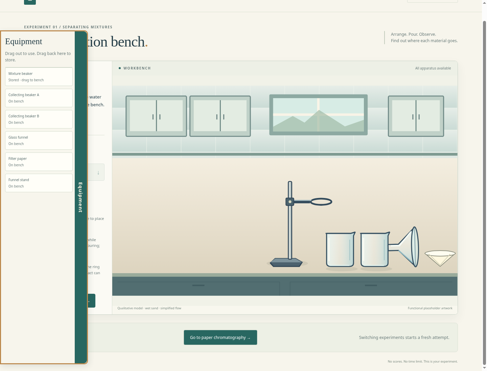
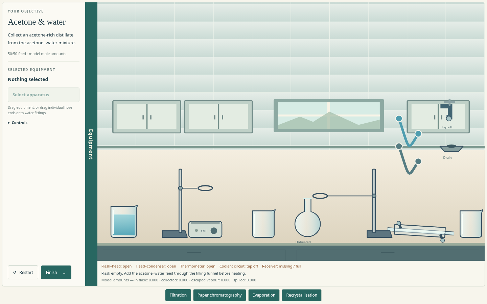
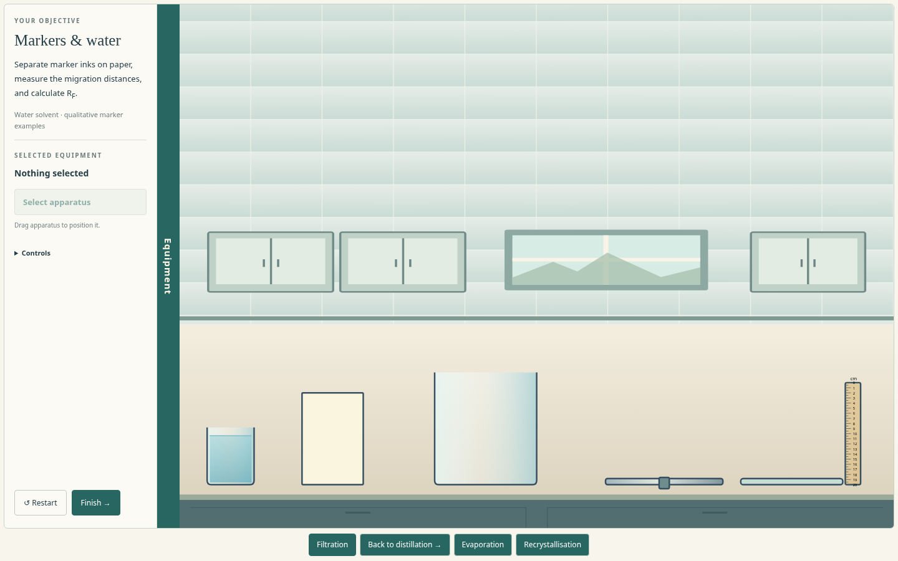

# Equipment menu review

Hover over **Equipment** at the left edge to reveal the drawer. Drag a **Stored** row to clear bench space. Drag a bench object back into the drawer to store it. Move the mouse away to collapse it.

The same drawer serves filtration, distillation and paper chromatography. Physical apparatus shelves are removed. Their tools start stored; other bench equipment keeps its original starting arrangement. Rows marked **On bench** select the existing object. No duplicate equipment is created.

Contents stay with their objects, including filter paper and sand contained in a funnel. External joints and hoses disconnect when storing equipment, and powered controls switch off. Stored objects leave the collision simulation and cannot receive a pour or run an experiment while hidden. Retrieval into occupied space is refused without discarding the object. Fixed tap/drain fittings remain on the bench.

Tab to access the drawer with the keyboard, Enter to retrieve a stored object into clear space, and Escape to close it. The menu remains available for inspection after Finish, but practical work stays stopped.

The storage unit checks cover all three lab models, preserved materials, contained filters, powered controls, disconnected joints, shelf replacement and blocked retrieval. Chromium checks cover hover hiding, drag-in/out, loaded contents, keyboard retrieval, restart, and the full lab workflows using tools from the drawer.

## Lab alignment revision — 22 October 2026

The drawer now starts at the first row beside the lab, in a narrow gutter aligned with the workspace. It scrolls with that lab instead of staying at the viewport edge. Hover, retrieval, contents-preserving storage and collapse are unchanged; only the visible drawer/tab accepts a storage drop.

## Drawer between objective and workbench

The latest layout places the Equipment tab in the divider immediately to the right of Your objective and to the left of the lab pane. It opens over the workbench and closes on mouse leave. Decorative page text has been removed and the laboratory now occupies nearly the whole window. The room extends to fill the pane without stretching apparatus.

## Explicit storage and occupied pickups

Every lab now has **Store selected equipment** in the selected-item controls. Select an apparatus directly or through the Equipment list, then click Store to recover it from a crowded setup. Its contents are retained; powered equipment turns off and connections detach as in drag-to-storage. Retrieve it from Equipment afterward. Fixed fittings cannot be stored.

A container/support can now be lifted with a loose tool or vessel resting on/in it. Those initial occupants no longer lock the initial pickup; unrelated obstacles still collide. Loose objects wake and fall when their support is stored, while explicitly attached children retain their existing storage behaviour.

Checks: 275 model tests pass; native checks cover all thirteen Store buttons, retrieval and content preservation, plus a loaded heater lift and a basin falling when the heater is stored. Existing filtration, calorimetry and responsive lab checks pass.
