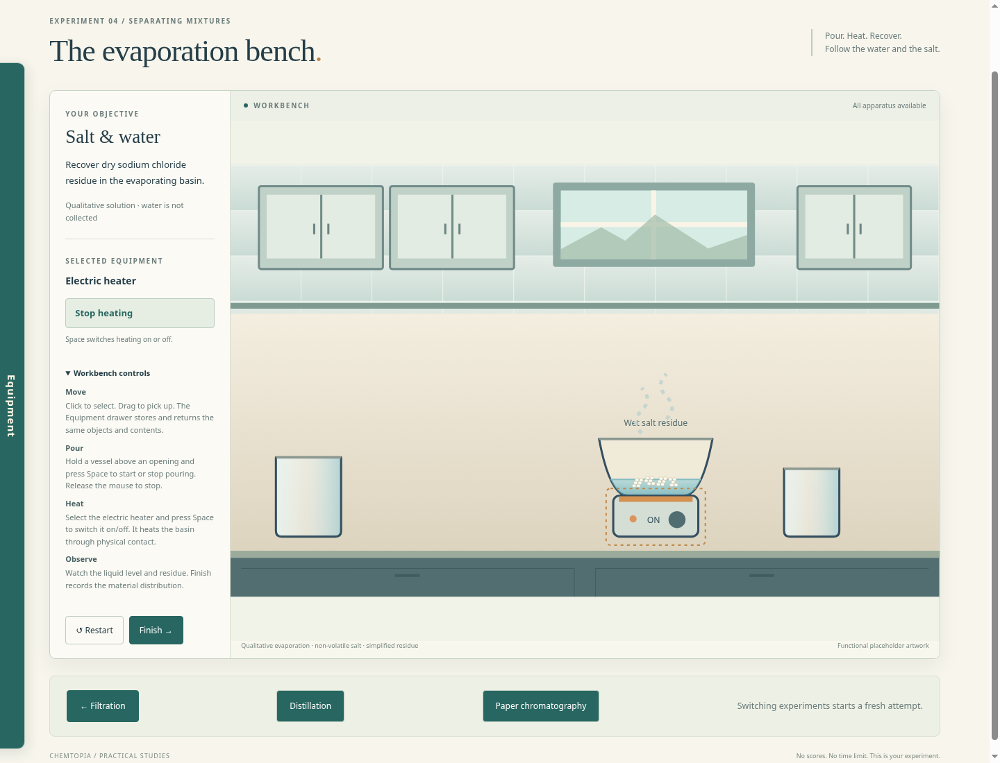
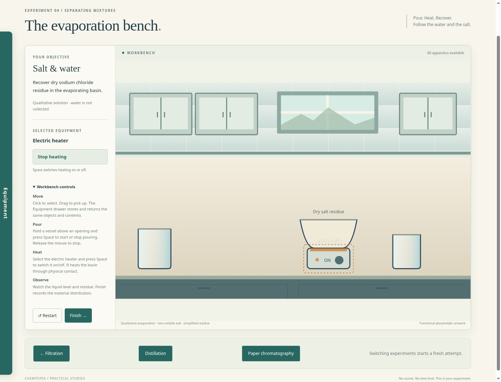
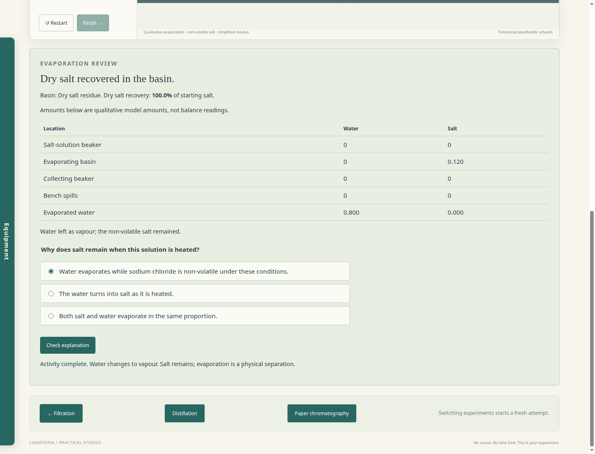

# Evaporation prototype review

Run `npm start` and select **Evaporation** at the bottom of any of the other three labs.

Pour salt solution into the evaporating basin using the existing held-vessel/Space control. Place the basin on the electric heater, select the heater and use Space or the action button to switch it on. Watch the liquid level and residue state, then Finish to review recovery and explain why salt remains.

Visible solid with remaining water is wet residue; it does not count as dry recovered salt. The first recovery container is the basin, without a new balance or scooping task. Water is tracked as vapour, while salt stays in vessels or spills. Incorrect setup, interrupted heating, missed pouring, overflow and tipping remain possible.

The amounts, heating rates and dissolved/solid representation are qualitative prototype defaults. They are not calibrated measurements or a detailed crystallisation model. Artwork remains project-owned functional SVG placeholders. See [the bounded specification](evaporation-prototype-spec.md) for exact assumptions and controls.

Verification passes 69 model/storage/physics checks and all five browser suites, including a real Chromium playthrough of transfer, stable heater contact, wet/dry stages, recovery, answer retry, restart, incomplete results and links to the existing labs. No deployment, backend, accounts, analytics or saving is introduced.
