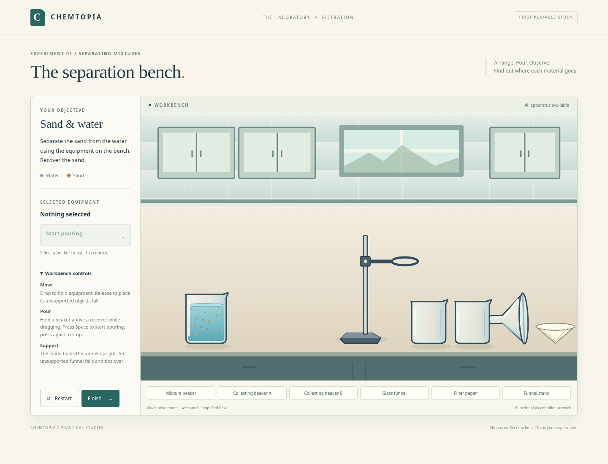
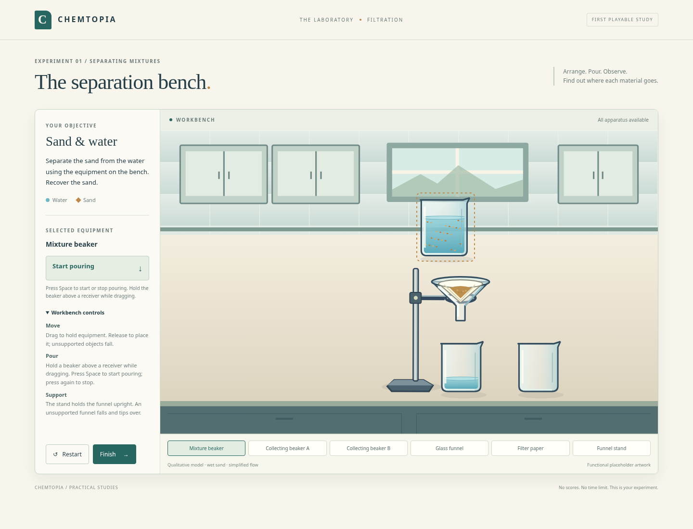
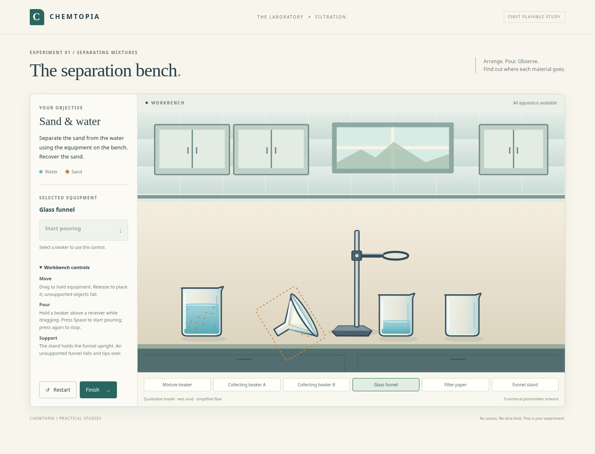

# Filtration prototype review

The first build followed the owner's “Yes” approval of [the specification](filtration-prototype-spec.md). Subsequent owner-requested revisions added Space toggling, removed movement shortcuts, then added collision-based gravity/tipping and spilled contents. See [the current physics interaction record](physics-interactions.md).

## Try it

With Node.js 22 or newer, run `npm start` from the repository root, then open `http://127.0.0.1:4173` on the same machine. No dependency installation is needed. See [VS Code instructions](../development.md) and [current controls](../../prototype/README.md).

Hold a beaker above a receiving opening by dragging, then press Space to start or stop pouring. Leave room for the beaker to tilt. Stop pouring and return it to a safe resting place before release. Solid equipment and the stand have collision shapes; an object can fall onto and disturb the setup. Arrow-key movement remains removed.

Finish stops the attempt and reviews material distribution; a successful separation opens the approved explanation question. Restart creates a fresh attempt. All six apparatus items remain available from the start.

## Corrected ring support

The bowl sits above the ring, with clearance from the rod and receiving beaker. The stand's base, rod, arm and ring edges are solid; the opening remains usable. Paper containment is intentional. Source and receivers are conserved through transfers.

## Tipped contents

Falling funnels have no timed in-air rotation. Contact, angular motion and gravity determine their resting angle. Tipped contents progressively transfer to receivers or bench spills, including retained sand on the paper. Nearby objects can prop up equipment.

All images here are Chromium screenshots at 1440 × 1100 of the implemented interface. Apparatus artwork remains original functional placeholders, rather than adopted reference images or production pixel sprites.

## Verification

- `npm test`: all 20 model/physics checks passed. They cover material conservation, filtration/wrong transfers, overflow, interrupted pours, holding/release, contact-driven tipping, ring seating, solid collision blocking, fast dragging, vessel contact, paper insertion, moving the seated assembly and tipped-content transfer.
- `npm run test:browser`: passed in real headless Chromium with mouse and keyboard input. Tested blocked stand crossing, clear-bench falling/tipping, higher ring seating, paper insertion, Space toggling/repeat protection, successful filtration and question retry/completion, loaded-funnel tipping/spillage, restart and missing-paper failure.
- No browser runtime exceptions occurred. Initial, supported-setup, completed and tipped-spill screenshots were visually reviewed.
- The static server exposes only the prototype directory; private curriculum documents remain ignored and untracked.

## Limits and next review

The sand/water model remains qualitative, with simplified transfer and filtration. Retained sand is wet. Liquids are not simulated as individual fluid particles; there is no settling/decantation or calibrated measurement.

Matter.js 0.20.0 runs from a local MIT-licensed copy. Collision shapes, masses, friction, support constraints, impact asymmetry and drain thresholds are approximations; folded paper is a rigid shape with an insertion exception. Glass breakage and impact damage are not simulated. Desktop Chromium is verified; other browsers and touch devices remain unverified.

There are no avatars, room navigation, further techniques, currency, saving, accounts, analytics or public deployment in this increment. The owner should playtest these revised interactions before choosing another feature.
