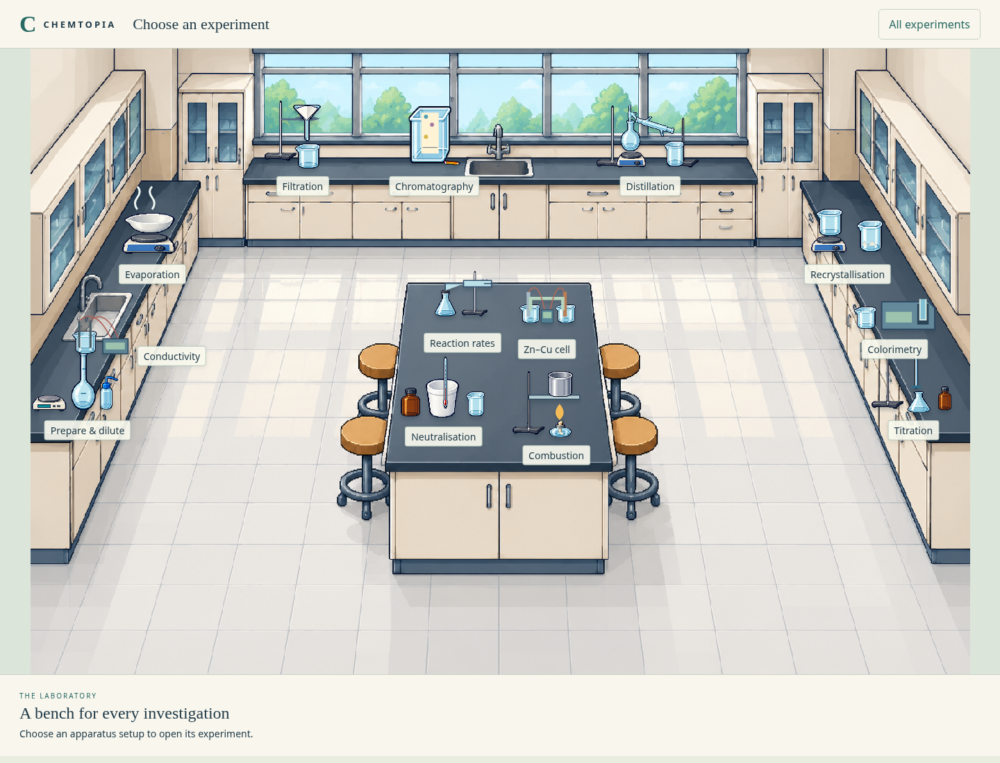
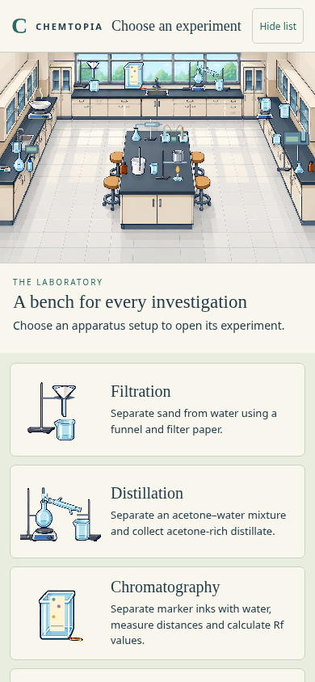

# Laboratory selection room

**Current room:** thirteen labs, including reaction rates, conductivity, colorimetry and zinc–copper cells. The original nine-lab increment is described below as historical context; the room images now show the current collection. See [the new-lab walkthroughs](measurement-labs-prototype-review.md).

Reaction rates was subsequently added as the tenth experiment; the room and list now offer ten choices.

The owner selected next-step suggestion 2: replace the temporary bottom links with a lab-selection screen, use the laboratory from the three earlier pictures as the background, and show experiment previews on its benches. Their earlier explicit choice was **L01-1**, the perimeter-bench room with one central workstation. This increment implements that room and the existing nine labs; it does not add notebook features, avatars, walking, new experiments, accounts, persistence or publication.

## Use

Run `npm start` and open the reported local address. The root now opens the laboratory selection room (`laboratory.html`). Click an apparatus setup on a bench to enter its experiment. Hover or keyboard-focus a setup to see its objective, then click or press Enter to open it. **All experiments** toggles a larger list with the same destinations and objectives. On phones that list is open by default, below the room, so selection does not depend on small illustrated targets.

Every workbench now has one **← Laboratory** link in place of the row of cross-lab links. Returning and opening a lab starts a fresh attempt, as previous navigation did. Browser Back also works; there is no saved progress or resume promise. The filtration workbench keeps its direct `index.html` URL; other existing lab URLs are unchanged.

## Artwork and previews

The room background is a newly generated adaptation of **only the selected left-hand L01-1 panel**, not either of the other two layout proposals. It preserves cream cabinets, dark perimeter benches, broad windows and a central island, removes the concept-sheet text and loose apparatus, and makes the room a single landscape background. [Asset provenance](../../prototype/assets/laboratory/README.md).

The nine clickable bench setups reuse the selected B equipment sprites. They are small static representations of filtration, distillation, chromatography, evaporation, recrystallisation, solution preparation/dilution, titration, neutralisation calorimetry and ethanol combustion calorimetry. They identify the destination; they are not running experiments or a record of the student's last attempt. The hub loads no experiment physics or chemistry simulation. Each actual lab retains its existing models, equipment and controls.

## Previews

## Verification

`tests/laboratory-browser.mjs` checks the room asset, all nine previews, native keyboard launch, entry/return for every experiment, the single return link on each lab, and the phone list and page width. Existing browser walkthroughs navigate through the new room rather than relying on removed cross-lab links. `npm run test:browser` includes the new test. Model checks remain `npm test`.

The owner's playtests of titration, calorimetry and the selected B artwork remain deferred, as requested. Automated checks do not imply owner acceptance of those activities.

Verification on 24 October 2026: all **163 model tests** and **eleven browser test scripts** passed, including all nine room-to-lab round trips, keyboard entry, the phone list, existing practical walkthroughs, and responsive lab layouts. Documentation links and `git diff --check` passed. Chemistry and physics model files are unchanged.

The three measurement additions use the same room and list. Adjacent previews now accept pointer hits on painted apparatus/captions rather than an invisible full preview rectangle, preventing a neighbouring experiment from intercepting a click. Native keyboard links remain available. A browser regression clicks the solution-preparation flask as well as every experiment caption, plus the phone list.
