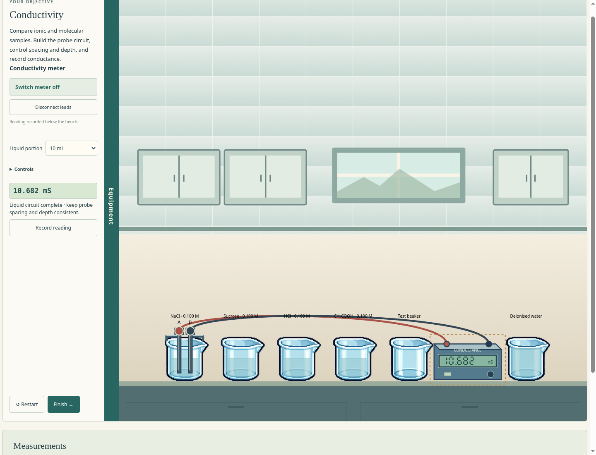
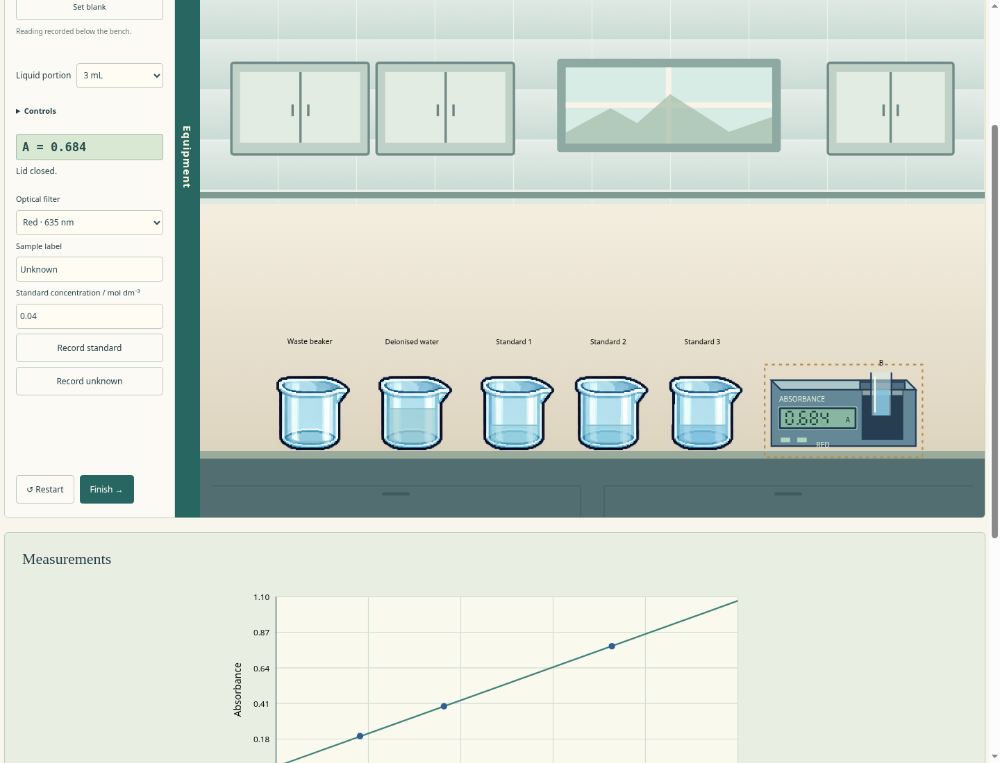
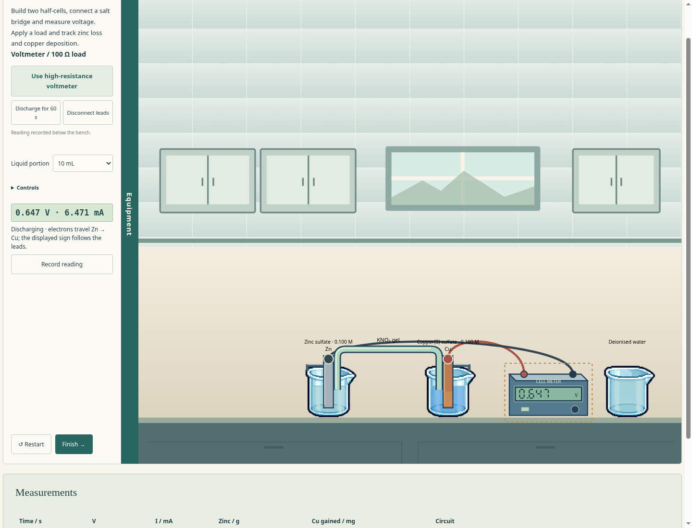
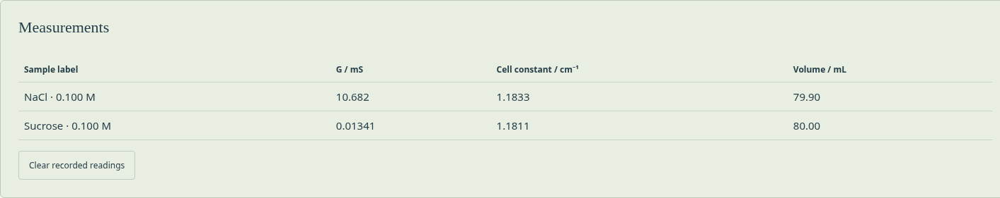
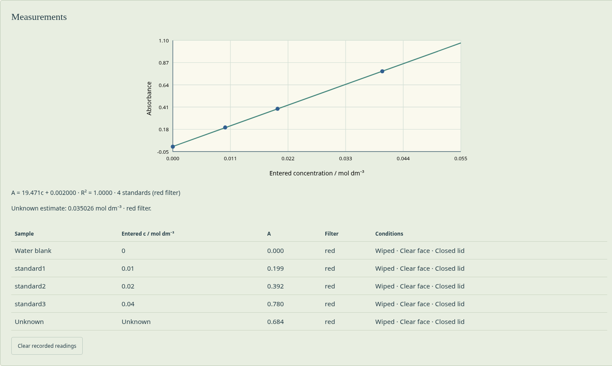
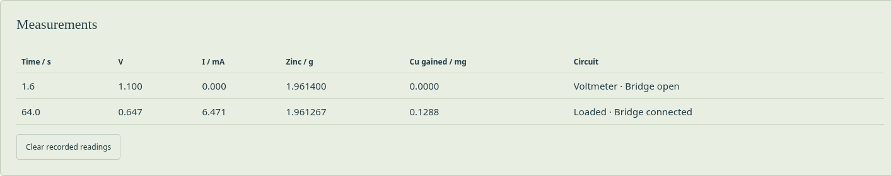

# Try the three measurement labs

Run `npm start` in the repository and open the local address. **Conductivity**, **Colorimetry** and **Zn–Cu cell** are now on the laboratory benches and in the list. Direct URLs are `/conductivity.html`, `/colorimetry.html` and `/voltaic.html`. No installation or account is required. All observations are discarded when you leave/reload a lab.

See also [instrument artwork provenance](../art/measurement-instruments.md).

The [specification](measurement-labs-prototype-spec.md) records recipes, controls, defaults, scientific limits and the [curriculum boundary](../curriculum/measurement-labs.md). The owner's request authorises these three labs; numerical choices are implementation defaults pending review.

## Conductivity walkthrough

1. Retrieve Probe A and Probe B. Drag each beside the NaCl sample and press Space to clip it to the rim.
2. Drag red and black lead ends to different probe terminals. Alternatively select each probe and choose its lead button. Select the meter and switch it on.
3. Record conductance. The table includes the actual model cell constant, so changing geometry is visible in the data.
4. Unclip and lift each probe clear of the glass before moving it to sucrose or water. Carried films contaminate the next sample. For a clean comparison, rinse each unmounted probe above waste, with the water beaker nearby.
5. Compare HCl/CH₃COOH, test dry NaCl, or add water to the dry sample and test again. A disconnected circuit gives no valid reading; intentional dry-solid contact gives an ideal zero.
6. Finish for ion/molecule reasoning and numerical conductivity/dilution practice.

## Colorimetry walkthrough

A convenient assisted-portion example is to prepare 50 mL standards using 5 + 45 mL, 10 + 40 mL and 20 + 30 mL of stock + water. From 0.100 M stock these are 0.0100, 0.0200 and 0.0400 M. These are metered model portions; real preparation should use appropriate calibrated apparatus. Store the stock bottle after preparing standards to make room for waste if needed.

1. Fill Cuvette A with 3 mL water. Select it and wipe its faces. Keep a clear face toward the beam.
2. With the instrument lid open, hold the cuvette near its well and press Space to insert. Close the lid; select **Set blank**.
3. Enter concentration `0`, label the water point, and record it as a standard.
4. Open the lid, remove/store the blank cuvette and use Cuvette B for samples. Fill with 3 mL standard, wipe, insert, close and record using your calculated concentration.
5. Between samples, remove the cuvette, hold it above waste and use Space to drain. A 0.05 mL film remains. Add water and drain again to rinse; repeated rinsing reduces carryover.
6. Record at least two non-zero standards in addition to water. The graph fits your recorded line with an intercept; it does not use hidden concentrations.
7. Measure the unknown using the same filter and conditions; choose **Record unknown**. Check whether the estimate lies inside your standards' range.
8. Explore an open lid, an absorbing blank, a filter change, fingerprints or the frosted face. The records retain those conditions. Finish uses your fitted line and unknown in a calculation, or explicitly labelled example data if no usable calibration exists.

## Zinc–copper cell walkthrough

1. Clip zinc to the zinc-sulfate beaker and copper to the copper-sulfate beaker. Select a strip near a vessel and press Space.
2. Connect red to copper and black to zinc. The ideal equal-concentration near-open-circuit reading is about +1.10 V. Swap leads and compare the sign.
3. Fit the KNO₃ bridge with one leg reaching each liquid. The bridge and electrodes are not pre-connected.
4. Select the meter and connect its **100 Ω load**. The terminal voltage falls below open-circuit EMF; a sustained current consumes zinc and Cu²⁺ while depositing copper.
5. Record the initial state, then use **Discharge for 60 s** and record again. This explicitly advances model time; it is not a reaction-speed challenge. The table includes current and metal changes.
6. Remove the bridge while loaded. Sustained current stops. High-resistance mode can still show a voltage indication; that alone is not a working-cell test.
7. Try zinc in copper sulfate. Copper can deposit directly on zinc without the external circuit. The app diagnoses these wrong/mixed half-cells rather than presenting them as the standard cell.
8. Finish for electron/ion flow, a given-equation deposition calculation and a clearly marked AHL E° question.

## Verification and what needs owner review

Model checks cover contact versus zero, ion/molecule contrast, geometry, weak-acid response, finite films/rinsing, dilution, optical faults, blanking, measured calibration, unknown estimation, metal/ion/charge balances, lead reversal, bridge failure, displacement, storage and freezing after Finish. Native Chromium checks use equipment dragging, real controls and wire-end dragging rather than injecting simulation state. Responsive/navigation checks include all thirteen labs.

These are prototypes with uncalibrated teaching coefficients. Owner playtesting, the new instruments' art, difficulty and teacher review of scientific simplifications remain pending. [Next-step suggestions and questions](next-review-and-questions.md) separate proposed refinements from implemented work.

### Recorded data previews

These are unedited browser captures of the actual observation sections, not ideal replacement data.

### Verification — 24 October 2026

**226 model tests pass**, including 39 checks for the new measurement labs. The complete **thirteen browser-harness suite passes**: existing practical workflows and reviews, all thirteen responsive layouts, keyboard/phone room navigation, storage, and the new native measurement workflows. After the final wire/label rendering adjustment, the three new native workflows were rerun and passed again. No browser runtime exceptions were reported. Syntax checks, local documentation targets and `git diff --check` passed.

The new browser walkthrough prepares standards through actual finite transfers, fills/rinses/seats cuvettes, blanks and records observations, fits an unknown near 0.035 M, drags wire ends, reverses polarity, tests an open bridge and discharges the cell. It does not inject model state. The illustration coefficients remain teaching defaults; these checks do not establish agreement with a real school instrument or owner acceptance.
