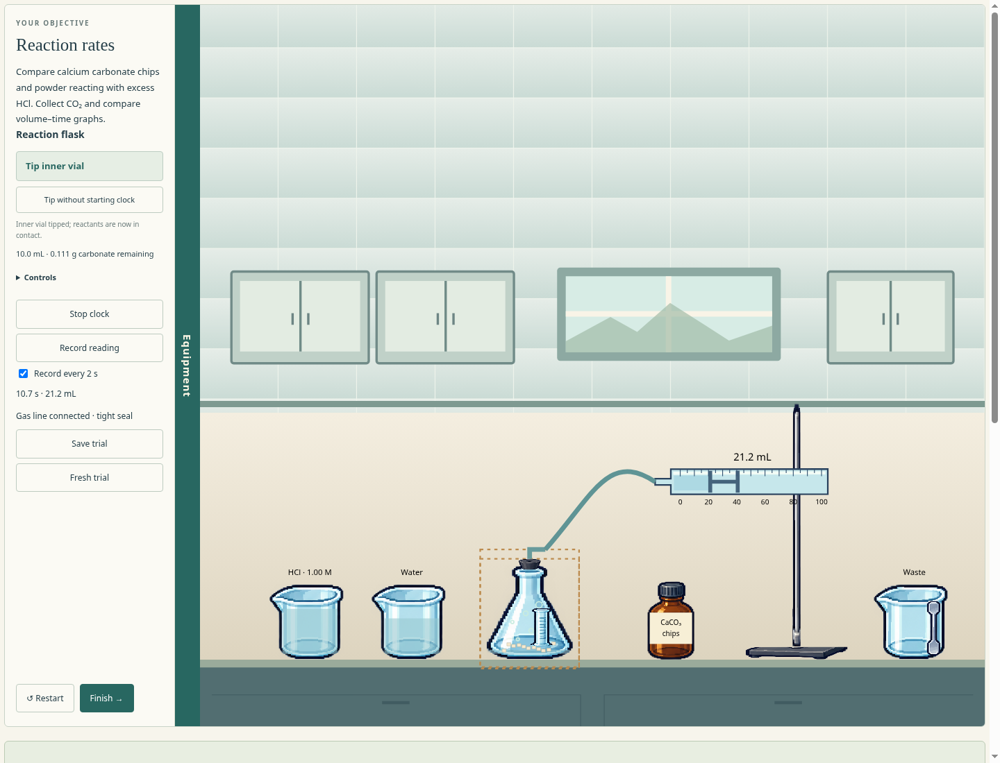
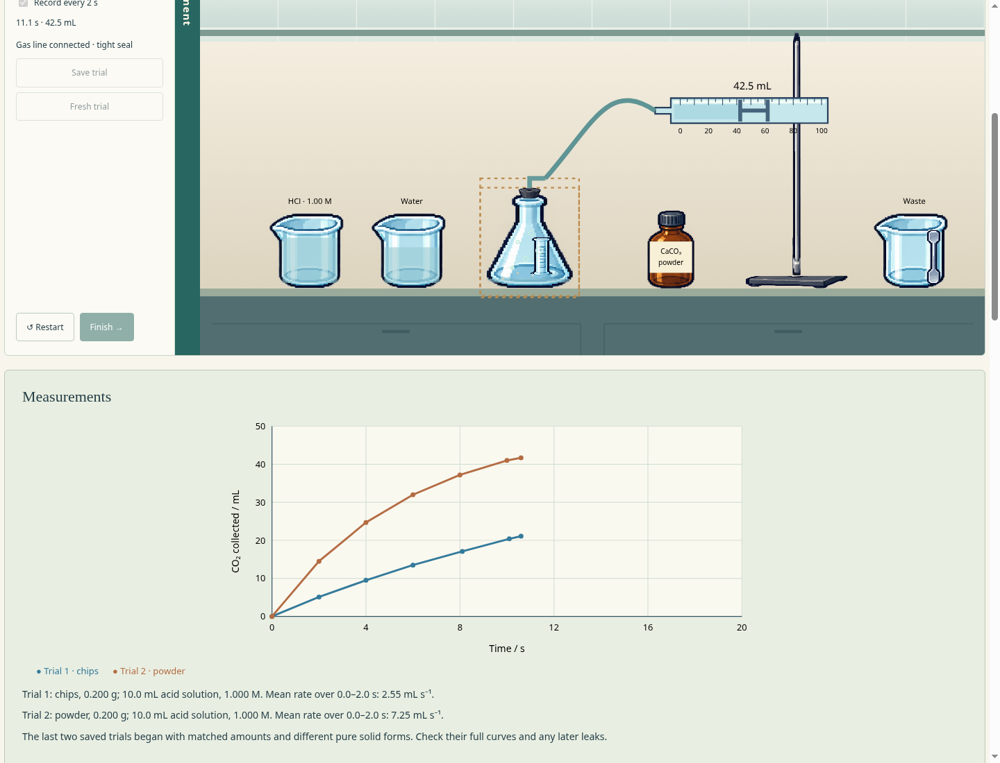

# Reaction rates — walkthrough and review

Run `npm start` and select **Reaction rates** on the central laboratory bench, or open `http://127.0.0.1:4173/rates.html` directly. Return with **← Laboratory**. No installation or accounts are needed.

## First comparison

1. Retrieve chips and put the bottle in clear bench space. Retrieve the spatula. Hold its scoop near the bottle and press Space for one 0.10 g portion, then move it over the open reaction flask and press Space to deliver. Repeat for **0.200 g**. Use the fine button if needed.
2. Place the empty inner vial gently on the bench. Hold HCl above it and add **10 mL** once. Move the vial near the flask mouth and use **Fit inside flask**; its acid remains separate from the chips.
3. Retrieve the gas syringe into clear space to the left of the stand. Bring its barrel near the upper clamp and use **Clamp to stand**. Fit the bung near the flask mouth, then select the syringe and **Connect tube**. The status reports a tight line or an actual open/leaking route.
4. Enable **Record every 2 s**, or use **Record reading** yourself. Select the flask and **Tip vial & start clock** to mix and start timing together. You can also operate the clock or tip without starting it independently. Read the piston face nearest the syringe inlet.
5. Observe the moving piston and bubbles. Scroll below the bench to see the measured table and graph. Let the curve approach a plateau before treating it as a final yield; an early stop is an incomplete reaction, not evidence of a smaller theoretical yield.
6. **Save trial**, then **Fresh trial**. Repeat with **0.200 g powder** and the same acid volume/concentration. Compare coloured curves, early mean slopes and eventual final volumes. Finish opens the three review questions.

The clock never pauses the chemistry. Late sealing, a loose connector, insufficient acid, changing quantities, water dilution, mixed solids and spills can all change the observations. Save keeps current observations in memory; current logging continues. Fresh trial gives fresh apparatus, while Restart or leaving/reloading discards the attempt. No cross-lab notebook or progress saving is implied.

## Preview

These are captures of the working lab. Older previews may show short, deliberately incomplete observation windows; the model checks also verify equal final yields after complete matched reactions.

[The specification](reaction-rates-prototype-spec.md) records equations, scientific simplifications, numerical defaults and the exact syllabus/source boundaries. The kinetic and leakage coefficients are teaching values, not calibrated measurements. The first graph calculation is an early mean rate, not a fitted initial tangent.

## Checks

Model checks cover matched final yields, faster powder reaction, acid limitation, dilution, leaking/open connections, syringe capacity and emptying, wrong-vessel reactions, mixed-solid exhaustion, clock behaviour, recorded precision, independent saved trials, changed conditions, storage, finish freeze and a physically supported syringe collider. Native browser input checks the complete two-trial preparation/assembly/measurement/review workflow, room entry/return and responsive layouts.

Run `npm test`, `node tests/rates-browser.mjs`, `node tests/laboratory-browser.mjs` and `node tests/layout-browser.mjs`. Chromium is required for browser checks. The new script is also included in `npm run test:browser`.

Verification on 24 October 2026: **181 model tests passed**, including 18 new reaction-rate checks. The focused native Chromium reaction-rate workflow, ten-lab room/navigation test and ten-lab responsive-layout test passed. The walkthrough uses real mouse/keyboard input without injecting experiment state, completes chips/powder trials and answers the actual numerical review. Chemistry and physics files for the previous nine experiments are unchanged.
