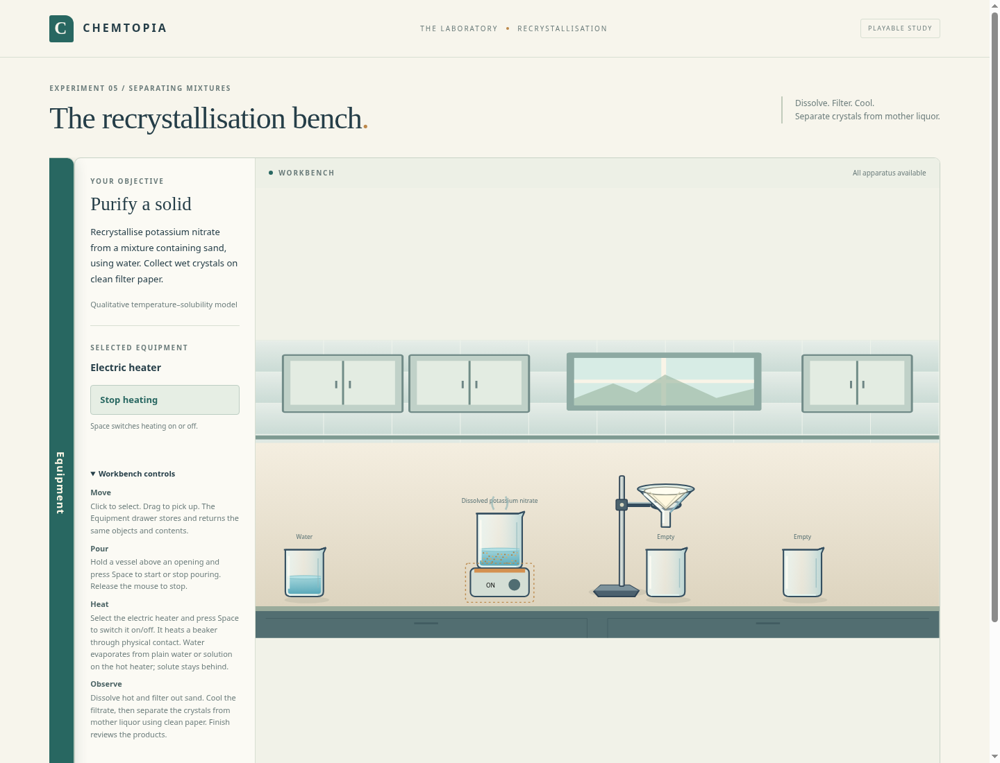
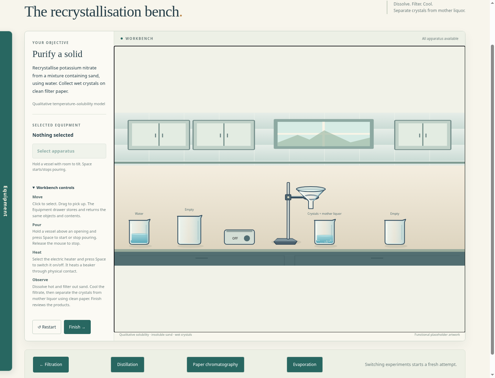
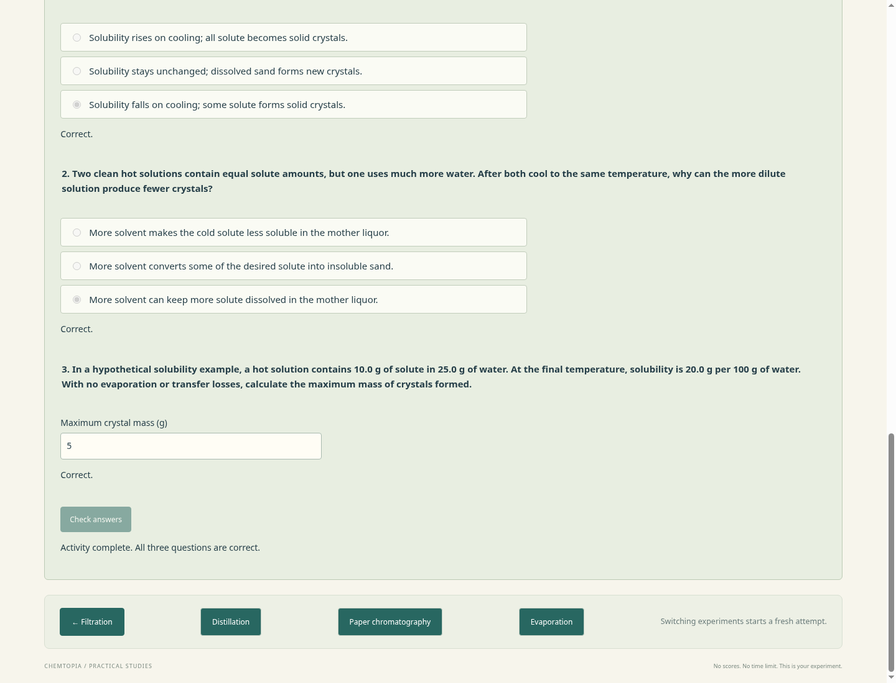

# Recrystallisation prototype review

Open **Recrystallisation** from the bottom of any earlier lab after running `npm start`.

Add water to the impure potassium nitrate, warm the beaker on the heater, and hot-filter into a receiving beaker. Cool the filtrate. Crystals can remain in the clean beaker with mother liquor; filtering them onto clean paper is optional. Both filter papers are available in the equipment drawer.

The model distinguishes undissolved starting material, dissolved solute and recrystallised solid, as well as sand and water. Catching original solid on a filter does not count as recrystallisation. Excess water, early cooling/collection, reused contaminated paper, absent paper, overflow and spills remain possible. Heating plain water or solution now evaporates water while leaving solute behind. Water vapour, liquids, solids and spills are all retained in the accounting.

The review distinguishes crystals in beakers from wet crystals isolated on paper. The reported fraction counts starting solute present as crystals in accepted locations, excluding dissolved solute; it is not isolated dry-product recovery. The first version uses a labelled qualitative temperature-dependent capacity, not verified potassium-nitrate solubility data or a numerical temperature prediction. See [the specification](recrystallisation-prototype-spec.md) for defaults and limits.

Screenshots are captured from the local Chromium playthrough using project-owned functional SVG placeholders. No final pixel artwork, publication, account or student-data feature is introduced.

The original first question is followed by an excess-solvent question and a harder hypothetical solubility calculation. See [all lab review questions](review-questions.md).
