# Visuelle referanser til neste designsamtale

Denne katalogen inneholder eksisterende bilder og illustrasjoner, ikke genererte bilder eller skjermbilder fra Chemtopia. Nye, genererte Chemtopia-forslag ligger separat i [grafikkforslagene](../art/README.md). Ingen retning eller spillressurs er godkjent. Velg gjerne bare enkelte egenskaper ved et bilde; et valg innebærer ikke at hele bildet eller ressurssettet skal brukes.

Du kan svare slik: «V02: liker tydelige regionforskjeller, men ønsker mindre detalj», eller «V05 fremfor V08 for faglige aktiviteter». Vi trenger ikke velge én samlet stilpakke.

## Oversikt

| ID | Del av spillet vi kan diskutere | Hva referansen viser |
| --- | --- | --- |
| V01 | Kart, samhandling og dialog | Svært enkel scene med tydelig dialogflate |
| V02 | Verden og regioner | Pikselnatur med ulike fargepaletter |
| V03 | Laboratoriets interiørstil | Benker og skap i detaljert pikselstil |
| V04 | Interiør og små gjenstander | Vasker i samme pikselstil |
| V05 | Faglig aktivitetsflate | Enkle, tydelige begerglass i vektorformat |
| V06 | Faglig aktivitetsflate | En mer detaljert kolbeillustrasjon |
| V07 | Forsøksoppsett | Byretteoppsett med flere apparatdetaljer |
| V08 | Alternativ faglig tegnestil | Et begerglass med annen form- og fargebehandling |

## V01 — Enkel interaksjon og tydelig dialogflate

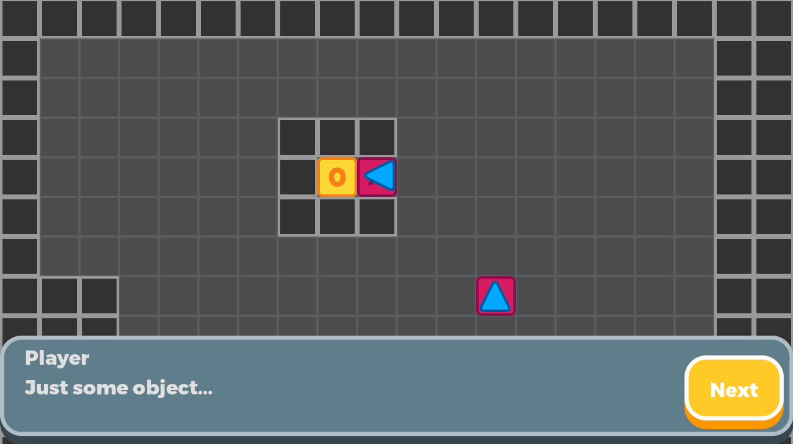

**Se på:** forholdet mellom kartet og teksten, tydelig knapp og hvor mye plass dialog tar.

**Avveining:** stor dialogflate kan gjøre teksten lesbar, men dekker mye av verdenen. Selve kartet er en teknisk demonstrasjon, ikke et forslag til Chemtopias ferdige utseende.

**Ikke overfør automatisk:** rutenettbevegelse, kamp, motorvalg, engelskspråklig tekst eller akkurat denne knappestilen. Vi har valgt jevn bevegelse i Q19.

Kilde: [Godots rollespilldemo](https://github.com/godotengine/godot-demo-projects/tree/master/2d/role_playing_game). Opphav: Godot Engine contributors. Repositorylisens: [MIT](credits/godot-MIT.txt). Bildet er lagret uendret som referanse.

## V02 — Farger og regionale uttrykk

**Se på:** gjenkjennelige flater, kanter og sammenhengende stil på tvers av paletter.

**Avveining:** mer detalj kan gjøre verdenen rikere, men kan skjule interaktive ting på telefon. Et særegent regionalt uttrykk kan hjelpe orientering, men kjemiske temaer må ikke reduseres til fargekoder.

**Ikke overfør automatisk:** årstider, biomer eller fantasytema som faglig regionstruktur. Vi har ikke knyttet bestemte kjemitemaer til bestemte miljøer.

Kilde: [LPC Revised / Eliza Wyatt og bidragsytere](https://github.com/ElizaWy/LPC). [README med stil og lisensinformasjon](https://github.com/ElizaWy/LPC/blob/main/README.md). Kilden oppgir CC-BY 3.0 eller OGA-BY 3.0; konkrete bidrag krever individuell kreditering. Dette oversiktsbildet er eksternt lenket, ikke kopiert inn som spillressurs. Visning krever nett.

## V03 — Benker og skap i pikselstil

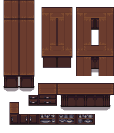

**Se på:** perspektiv, dybde, gjenkjennelig innredning og detaljgrad.

**Avveining:** dette trepreget kan passe en varm verden, men er ikke et bilde av et moderne kjemilaboratorium. Det må vurderes om et slikt uttrykk passer din setting.

Kilde: [Countertop.png i LPC Revised](https://github.com/ElizaWy/LPC/blob/main/Objects/Furniture/Countertop.png). Kunstnere: Lanea Zimmerman (Sharm) og Eliza Wyatt (DeathsDarling). OGA-BY 3.0. Originalt grunnlag fra [LPC modified base tiles](https://opengameart.org/content/lpc-modified-base-tiles); endringer og farger ved Eliza Wyatt. [Kildens krediteringer](credits/lpc-furniture-credits.txt). Ingen endring av bildet er gjort her.

## V04 — Små interiørgjenstander

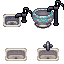

**Se på:** hvor mye en liten gjenstand kan fortelle, og om den er gjenkjennelig ved vanlig skjermstørrelse.

**Avveining:** detaljer som ser fine ut forstørret kan være vanskelige å oppfatte på kartet. Faglig viktige deler kan trenge en egen nærvisning.

Kilde: [Sink, Countertop.png i LPC Revised](https://github.com/ElizaWy/LPC/blob/main/Objects/Furniture/Sink%2C%20Countertop.png). Kunstnere: Lanea Zimmerman (Sharm) og Eliza Wyatt (DeathsDarling). OGA-BY 3.0. Originalt grunnlag fra [LPC modified base tiles](https://opengameart.org/content/lpc-modified-base-tiles); endringer og varianter ved Eliza Wyatt. [Kildens krediteringer](credits/lpc-furniture-credits.txt). Bildet er uendret.

For V03–V04: [OGA-BY 3.0-lisens](https://static.opengameart.org/OGA-BY-3.0.txt). Krediteringene gjelder referansebildene; de er ikke en beslutning om å bruke disse ressursene i spillet.

## V05 — Enkle fagillustrasjoner

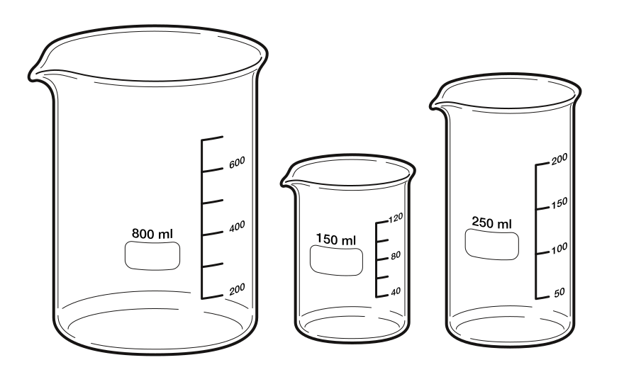

**Se på:** tydelige konturer, få distraksjoner og lesbarhet i ulike størrelser.

**Avveining:** skarp vektorgrafikk kan fungere godt for apparatdetaljer, men skiller seg fra kartets pikselstil.

Kilde: [Bioicons, Xavax: Beakers](https://github.com/duerrsimon/bioicons/blob/master/static/icons/cc-0/Lab_apparatus/Xavax/Beakers.svg). CC0 ifølge kildens ikonregister. [CC0-tekst](credits/bioicons-CC0.txt). Uendret referanse.

## V06 — Kolbe med flere detaljer

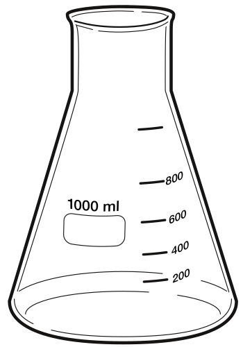

**Se på:** silhuett, apparatdetaljer og hvor mye visuell realisme du ønsker.

**Avveining:** flere detaljer kan gjøre et apparat lettere å kjenne igjen, men kan også oppfattes som mer presist eller målbart enn den planlagte simuleringen er.

Kilde: [Bioicons, Xavax: 1000 ml Erlenmeyer flask](https://github.com/duerrsimon/bioicons/blob/master/static/icons/cc-0/Lab_apparatus/Xavax/1000_ml_Erlenmeyer_flask.svg). CC0 ifølge kildens ikonregister. [CC0-tekst](credits/bioicons-CC0.txt). Uendret referanse.

## V07 — Et mer sammensatt forsøksoppsett

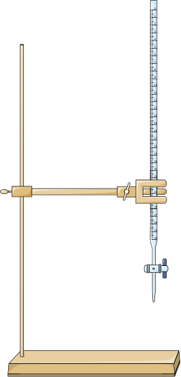

**Se på:** komponentenes synlighet og hvor mye plass et oppsett trenger på en telefon.

**Avveining:** en stor apparatillustrasjon kan gi faglig oversikt, men gir mindre plass til data, tekst og kontroller.

Kilde: [Bioicons: burette-assembled](https://github.com/duerrsimon/bioicons/blob/master/static/icons/cc-by-3.0/Chemistry/Servier/burette-assembled.svg). Opphav: [Servier Medical Art](https://smart.servier.com/), lisens [CC-BY 3.0 Unported](https://creativecommons.org/licenses/by/3.0/). [Lokalt lagret lisenstekst](credits/bioicons-CC-BY-3.0.txt). Bildet er ikke endret.

## V08 — Alternativ stil for samme type utstyr

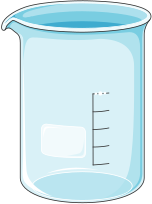

**Se på:** hvordan denne fremstillingen sammenlignes med V05 i kontur, skygge og detalj.

**Avveining:** dekorative detaljer kan bidra til gjenkjennelse, men bør ikke forveksles med informasjon eleven skal tolke faglig.

Kilde: [Bioicons: beaker-empty](https://github.com/duerrsimon/bioicons/blob/master/static/icons/cc-by-3.0/Chemistry/Servier/beaker-empty.svg). Opphav: [Servier Medical Art](https://smart.servier.com/), lisens [CC-BY 3.0 Unported](https://creativecommons.org/licenses/by/3.0/). [Lokalt lagret lisenstekst](credits/bioicons-CC-BY-3.0.txt). Bildet er ikke endret.

## Hva disse referansene ikke avklarer

Figurdesign, komplett laboratorieutseende, telefonoppsett, kjemiske partikkelmodeller og produksjonsgrafikk er ikke ferdig utredet. Et apparatbilde godkjenner heller ikke en forsøksmetode, sikkerhetspraksis, skala eller kjemisk forklaring. De faglige detaljene må gjennomgås mot dine kilder.

## Kildespor

[sources.json](sources.json) inneholder kilde-URL, opphav, lisensopplysning og SHA-256 for innhentede bilder. Lokale bilder er uendret og ligger bare under dokumentasjon. V02 er bevisst beholdt som ekstern referanse med lenke til samlingens kreditering.

Bioicons-opplysninger er kontrollert mot [icons.json](https://github.com/duerrsimon/bioicons/blob/master/static/icons/icons.json). Individuelle lisenser gjelder illustrasjonene; en samlet programvarelisens for en nettside erstatter dem ikke.

## Flere retninger: 2,5D og alternativer til pixel art

**2,5D** beskriver her et uttrykk med synlig dybde, ofte sett skrått ovenfra. Det kan lages med 2D-bilder eller med 3D-modeller. **Isometrisk** betyr et bestemt skrått perspektiv uten vanlig perspektivforminskning. **Low-poly** betyr enkle 3D-former med relativt få flater. Disse ordene beskriver ikke i seg selv kontrollene, læringsinnholdet eller hvilken teknologi vi må velge.

Brukeren har åpnet visuell retning på nytt: pikselgrafikk er nå en kandidat sammen med andre uttrykk. Ingen av alternativene nedenfor er valgt.

### V09 — Isometrisk 2D med illustrert dybde

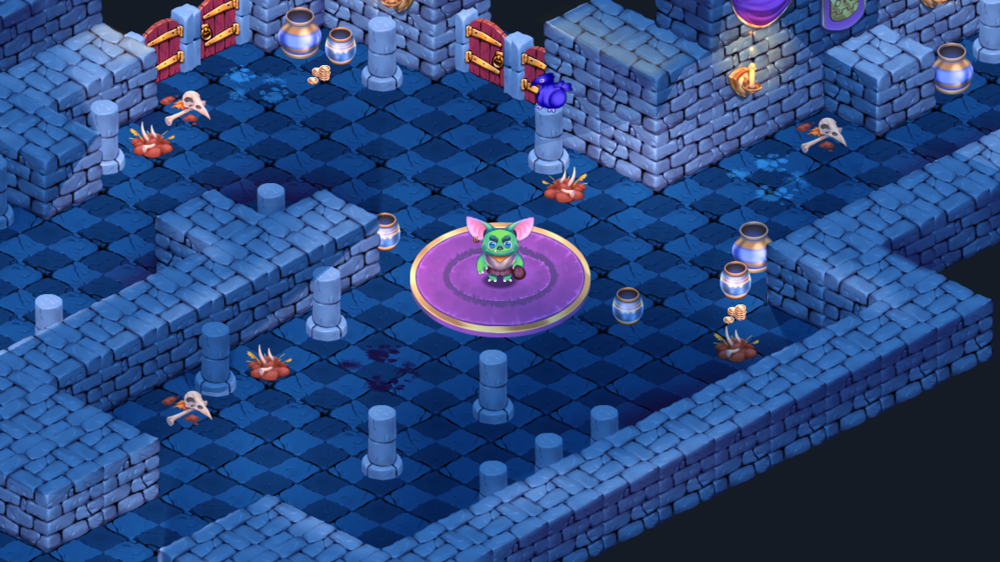

**Se på:** romfølelse, høydeforskjeller og hvordan en figur plasseres foran og bak vegger. Uttrykket er langt mer illustrert enn den enkle pikselreferansen.

**Mulig verdi:** et laboratorium kan få tydelig dybde uten at eleven styrer et fritt kamera.

**Avveining:** vegger og benker kan skjule utstyr eller figuren. Det må løses i et eventuelt design, ikke overses fordi perspektivet ser pent ut.

**Bare visuell referanse:** fantasyfigurer, skjeletter, mynter og mørk stemning er ikke foreslått som innhold i Chemtopia.

Kilde: [Godots isometriske demo](https://github.com/godotengine/godot-demo-projects/tree/master/2d/isometric). Godot Engine contributors, repositorylisens [MIT](credits/godot-MIT.txt). Skjermbildet er uendret.

### V10 — En liten, oversiktlig verden med 3D-former

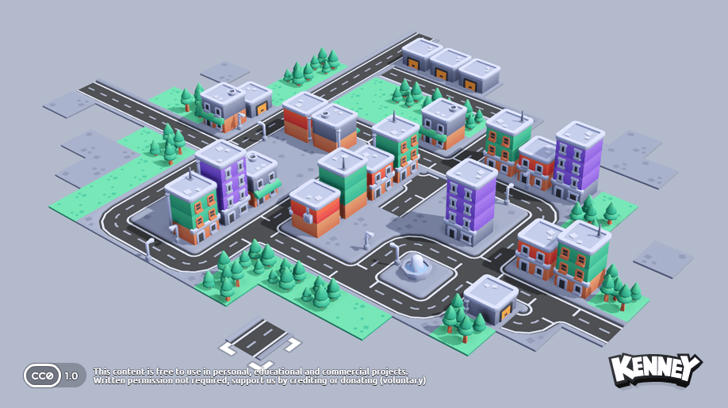

**Se på:** lesbare tak, veier, tydelige silhuetter og behersket detaljmengde i et skrått oversiktsbilde.

**Mulig verdi:** en sammenhengende fagverden kan være lett å orientere seg i når bygninger og ruter er klare.

**Avveining:** en kartoversikt er ikke samme utsnitt som et kamera som følger en figur. Vi må vurdere hvordan valget i Q19 eventuelt skal endres.

**Ikke overfør:** bybygging, veibygging, biltrafikk eller store avstander mellom kjemiaktiviteter.

Kilde: [Kenney Starter Kit City Builder](https://github.com/kenneyNL/Starter-Kit-City-Builder). Kenney, programvare MIT og inkluderte ressurser CC0 ifølge [kildens README](credits/Starter-Kit-City-Builder-README.md). Skjermbildet er uendret.

### V11 — Avrundede, enkle 3D-former

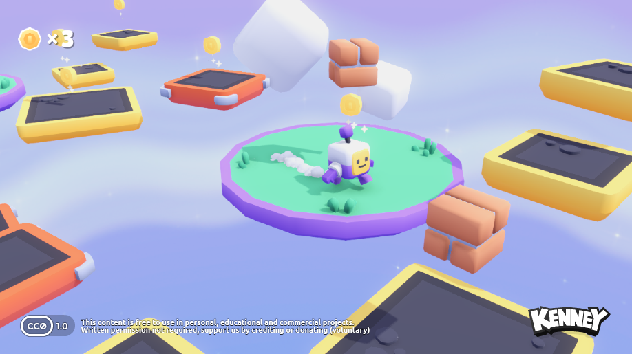

**Se på:** store former, myke skygger, figurens tydelige silhuett og begrenset overflatedetalj.

**Mulig verdi:** figurer og utstyr kan fremstå vennlige og gjenkjennelige uten pikselgrafikk.

**Avveining:** akkurat dette uttrykket kan oppleves yngre enn målgruppen på 16–19 år. En roligere palett og mindre lekepreget figurdesign kan vurderes separat.

**Ikke overfør:** hopping, plattformer, mynter, poeng eller krav til koordinasjon. Referansen gjelder form og lys.

Kilde: [Kenney Starter Kit 3D Platformer](https://github.com/kenneyNL/Starter-Kit-3D-Platformer). Kenney, MIT/CC0 ifølge [kildens README](credits/Starter-Kit-3D-Platformer-README.md). Skjermbildet er uendret.

### V12 — Tydelig 2D-grafikk uten piksler

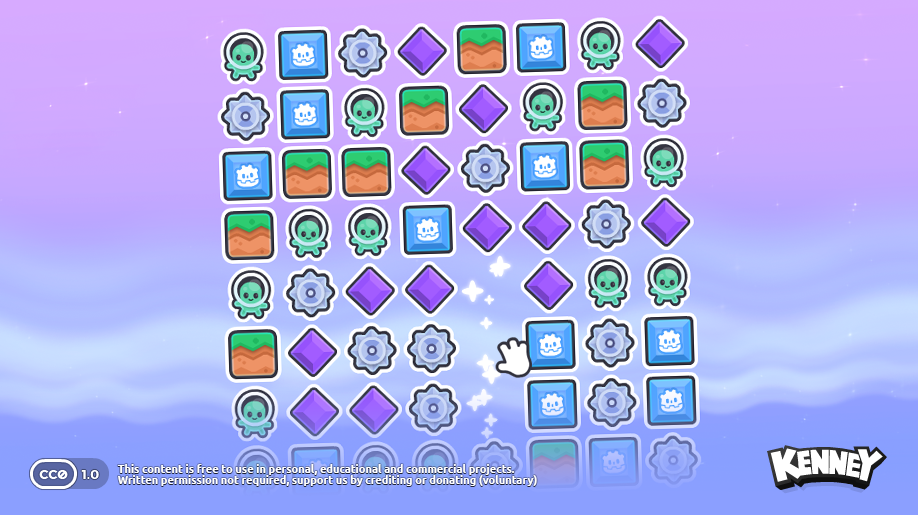

**Se på:** avrundede konturer, symbolenes størrelse og hvordan ulik form supplerer farge.

**Mulig verdi:** verktøyvalg og aktivitetskort kan være tydelige på telefon uten at grensesnittet må bruke pikselgrafikk.

**Avveining:** mange sterke farger, symboler og effekter samtidig kan gi for mye visuell støy rundt kjemien.

**Ikke overfør:** match-3, samling, spillbrett eller de avbildede symbolene som kjemiske modeller.

Kilde: [Kenney Starter Kit Match-3](https://github.com/kenneyNL/Starter-Kit-Match-3). Kenney; liten Godot-logo ved Kay Lousberg. MIT/CC0 ifølge [kildens README](credits/Starter-Kit-Match-3-README.md). Skjermbildet er uendret.

### V13 — Lys, materialer og enkel geometri

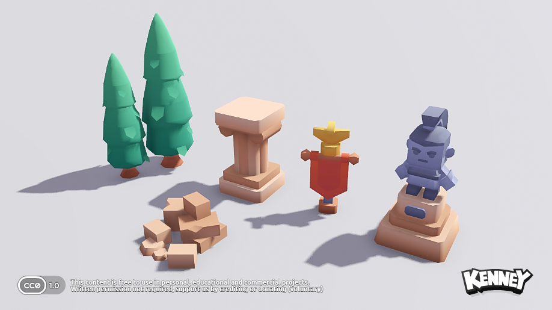

**Se på:** matte overflater, rolige bakgrunner og tydelige skygger som skiller gjenstandene fra gulvet.

**Mulig verdi:** laboratorieutstyr kan få lesbar dybde uten fotorealistiske teksturer.

**Avveining:** skygger som fungerer i et stort bilde kan bli mørke felt på en liten skjerm. Glass og tynne apparatdeler krever mer omtanke enn de solide formene her.

**Ikke overfør:** middelaldersetting, våpen eller dekorative trofeer.

Kilde: [Kenney Starter Kit Basic Scene](https://github.com/kenneyNL/Starter-Kit-Basic-Scene). Kenney, MIT/CC0 ifølge [kildens README](credits/Starter-Kit-Basic-Scene-README.md). Skjermbildet er uendret.

## Hvilke sammenligninger er mest nyttige?

| Retning | Referanser | Viktig å avklare |
| --- | --- | --- |
| Enkel pikselverden | V01–V04 og P01/P02 i grafikkforslagene | Om små apparatdetaljer fortsatt kan leses |
| Tegnet isometrisk 2D | V09 og generert S2 | Synlighet bak innredning og enkel navigasjon |
| Stilisert 3D med fast kamera | V10, V11, V13 og generert S3 | Om dybden hjelper, uten at kameraet blir en ekstra oppgave |
| Ren 2D eller blandet uttrykk | V05–V08 og V12 | Hvordan kart og faglige aktiviteter kan ha forskjellige uttrykk uten å virke usammenhengende |

Ingen retning er objektivt «bedre» uten at vi vurderer lesbarhet, aldersuttrykk og brukervennlighet i den faktiske aktiviteten. Vi kan velge detaljer fra flere referanser uten å kopiere en eksisterende spillstil.
